# Kaname ER 図 v1.1（段階 1 の範囲）

作成 2026-09-08 ／ 更新 2026-09-27（D-098：検索用のベクトルと、それを作るモデル）／ 2026-09-15（D-069〜D-077：層と権限・出来事と失効・運営・往復するもの・取り込みと連携を追加）/ DB: PostgreSQL 16+ (pgvector) / ORM: Drizzle
推定テーブル数: **77**（＋ §16 第1フェーズの表 37・2026-11-03）（段階 1。§1〜§6 の 37 ＋ §7 マスタ 8 ＋ §9〜§13 の 38。カード決済（段階 2・D-002）と BYOK／運営マネージド（段階 2・D-055）だけが後）

---

## 全テーブル共通の列（省略記法 `<common>`）

```
id            uuid PRIMARY KEY          -- UUID v7
tenant_id     uuid NOT NULL             -- 全テーブル必須。RLS が使う
created_at    timestamptz NOT NULL
updated_at    timestamptz NOT NULL
created_by    uuid
updated_by    uuid
deleted_at    timestamptz               -- 論理削除
```

`<scoped>` = `<common>` ＋ `scope_id uuid NOT NULL`（4 層のどれに属するか）
`<versioned>` = `<scoped>` ＋ `version int NOT NULL`（＋ 履歴テーブルを持つ）

---

## 1. テナント・組織・メンバー（6）

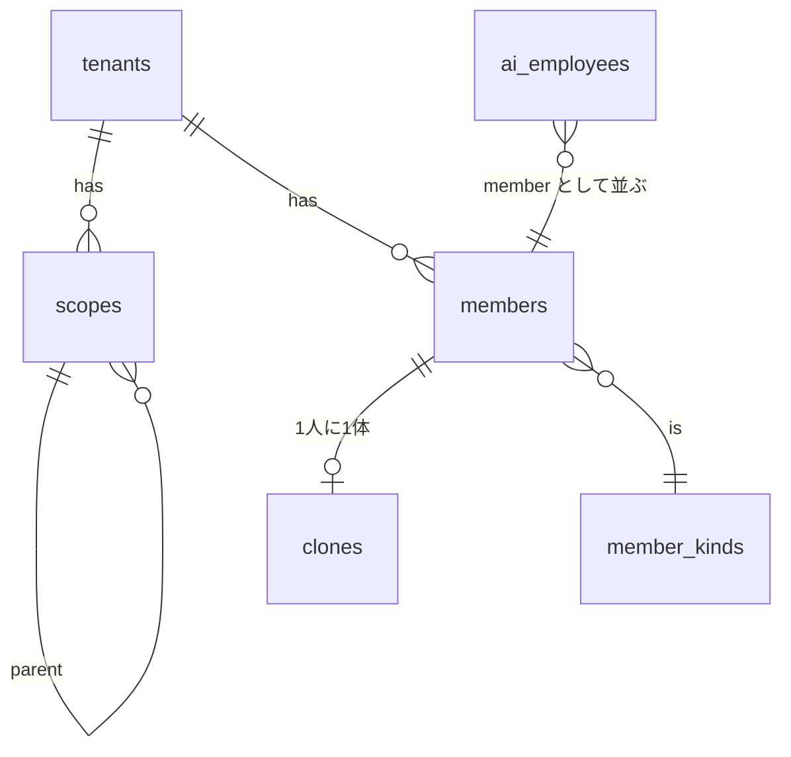

| テーブル | 主な列 | 備考 |
|---|---|---|
| `tenants` | `<common>` / `name` / `plan_id` / `status_id` / **`live_at`** / **`live_by`**（本番に切り替えた日時と人。切り替える前の確認に赤が無いときだけ `app.onboard_golive_switch` が書く ← D-116.5・D-028.4） | 契約の単位。切り替える前の確認は `app.onboard_golive`（会社モデル・Bridge・承認のルール・AI社員ごとのログイン情報と目標を本物の記録から） |
| `scopes` | `<common>` / `parent_id` / `layer_id` / `name` / `ticket_prefix`（番号の頭・例 EG。後から変えても、作ったチケットの番号は変わらない ← D-128.115）/ `next_ticket_no` | **4 層の実体**（運営／会社／部署／個人）。層は省略可 |
| `member_kinds` | `key` / `label` | **マスタ**（human / ai_employee / clone / 将来 guest） ← E20 |
| `members` | `<scoped>` / `kind_id` / `display_name` / `role_id` / `manager_member_id` / `auth_user_id`（認証の利用者。Better Auth の user。AI社員・自分のAI は null） / `setup_step`（はじめの設定をどこまで通したか 0〜6・D-089）/ **`agent_permission_mode`**（自分のAI の許可のモード。既定 default。全部許可は本人が選んだときだけ・D-104.14）/ **`agent_model`** / **`agent_effort`**（本人が選んだモデルと考える強さ・D-104.13） | **人間と AI が同じ席に座る**。はじめの設定の進み具合は人ごと（Bridge はその人の PC・ログイン情報はその人が預ける） |
| `setup_steps` | `n`（1〜6・PK） / `label` | **マスタ**（`<common>`）。はじめの設定の段の名前。1 PCをつなぐ／2 話す／3 たたき台／4 ログイン情報／5 テスト／6 本番へ（D-089） |
| `clones` | `<common>` / `owner_member_id` / `persona` | 各個人の写し。1 人 1 体 |
| `ai_employees` | `<scoped>` / `member_id` / `provisioning_id` / `template_ref` / **`paused_at`** / **`paused_reason`**（「止めたまま本番へ」。足りない AI社員を動かさないまま切り替える。`app.golive_pause` で付け外し・証跡 ← E-DEP-004・D-116.5） | ← E19（出どころ）|

---

## 2. 会社モデル ── 目標（9）

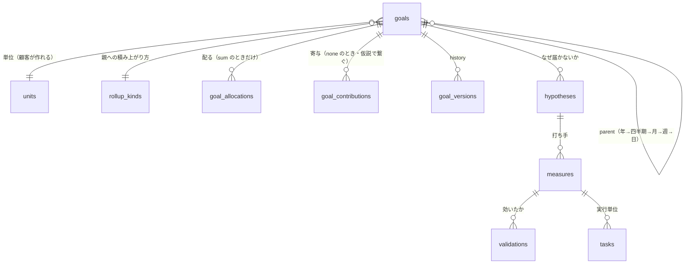

| テーブル | 主な列 | 備考 |
|---|---|---|
| `goal_kinds` | `key` / `label` / `progress_strategy` | **マスタ**（numeric / state / habit）← **E14** |
| **`units`** | `<scoped>` / `key` / `label` / `symbol` / `value_type_id` / `decimals` | **★新設マスタ。顧客が作れる。**運営が列挙しない（円・件・%・時間・回・独自スコア…）|
| **`rollup_kinds`** | `key` / `label` | **★新設マスタ。**親への積み上がり方 = `sum`（そのまま足す）/ `convert`（変換して足す）/ `none`（足さない） |
| `goals` | `<versioned>` / **`ended_at`**（無くす＝消さない）/ `parent_id` / **`rollup_kind_id`** / **`rollup_spec jsonb`** / `kind_id` / `period_start` / `period_end` / `target_value` / `unit_id` / `origin_id` | `origin` = 配られた／自主。**`rollup_kind` は「この目標が親にどう積み上がるか」**。`rollup_spec` は変換の定義（式・係数）を入れる**開いた器**。中身は目標設定スキルが決める |
| `goal_allocations` | `<common>` / `goal_id` / `assignee_member_id` / `allocated_value` / `agreement_status_id` | **`rollup_kind = sum` のときだけ使う。** 未配分＝親の target − 子の合計 |
| **`goal_contributions`** | `<common>` / `child_goal_id` / `parent_goal_id` / `hypothesis_id` / `verdict_id` | **★新設。`rollup_kind = none` のとき、どの仮説で親に効くかを繋ぐ。**効いたかは `validations` で検証する |
| `goal_versions` | `<common>` / `goal_id` / `version` / **`name`**（目標の名前。今期の売上 など ← D-108.1）/ `snapshot jsonb` / `changed_at` / `changed_by` | 期中変更の履歴。会社のデータなので `<common>`（tenant_id で分離。全員が読めるマスタではない）。**目標の名前は版に持ち、画面は今の版（goals.version と同じ版）の名前を出す（D-108.1）** |
| `hypotheses` | `<scoped>` / `goal_id` / `statement` / `evidence` | **目標とタスクの間の層** |
| `measures` | `<scoped>` / `hypothesis_id` / `statement` / `expected_effect` | 施策 |
| `validations` | `<common>` / `measure_id` / `measured_value` / `verdict_id` / `measured_at` | 検証 |

---

## 3. 会社モデル ── 台帳（動的スキーマ）（5）

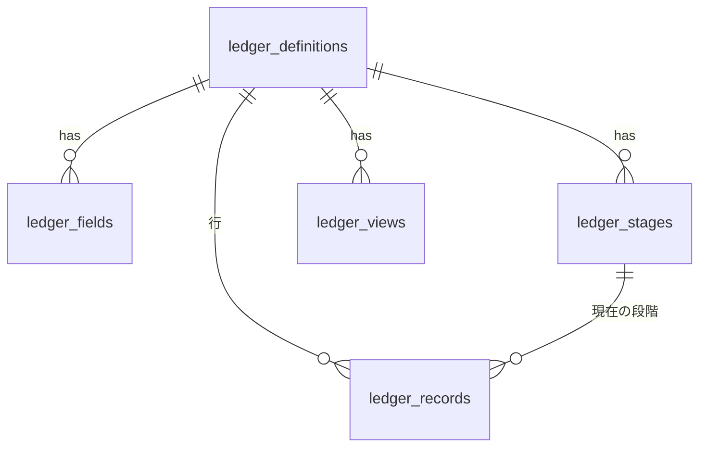

| テーブル | 主な列 | 備考 |
|---|---|---|
| `ledger_definitions` | `<versioned>` / `kind_id` / `name` / `json_schema jsonb` | `kind` = funnel / transaction ← **E4** |
| `ledger_fields` | `<common>` / `definition_id` / `key` / `label` / `data_type_id` / `required` / `options_master_id` / `order_no` / **`is_filterable`** / `is_sortable` | `is_filterable=true` の項目に**式インデックスを自動生成** |
| `ledger_stages` | `<common>` / `definition_id` / `key` / `label` / `order_no` / `rules jsonb` | `rules` ← **E18**（値域・状態遷移・しきい値・期限） |
| `ledger_views` | `<scoped>` / `definition_id` / `kind_id` / `filters jsonb` / `sorts jsonb` / `columns jsonb` | `kind` = list / kanban / calendar / chart ← **E17** |
| **`ledger_records`** | `<scoped>` / `definition_id` / **`stage_id`** / **`amount numeric(18,4)`** / **`occurred_on date`** / **`assignee_id`** / **`goal_id`（任意）** / **`measure_id`（任意）** / `data jsonb` | **太字＝固定列**（目標の集計に使う）。それ以外は `data` |

### インデックス

| 索引 | 種類 | 目的 |
|---|---|---|
| `(tenant_id, definition_id, stage_id)` | B-tree | ファネル集計 |
| `(tenant_id, definition_id, occurred_on)` | B-tree | 期間集計 |
| `(tenant_id, definition_id, assignee_id)` | B-tree | 担当別 |
| `data` | **GIN**（`jsonb_path_ops`） | 自由項目の汎用検索 |
| `(data->>'<key>') WHERE definition_id = '<uuid>'` | **式・自動生成・CONCURRENTLY** | `is_filterable` の項目のみ |

---

## 4. 会社モデル ── 担当業務・記憶（5）

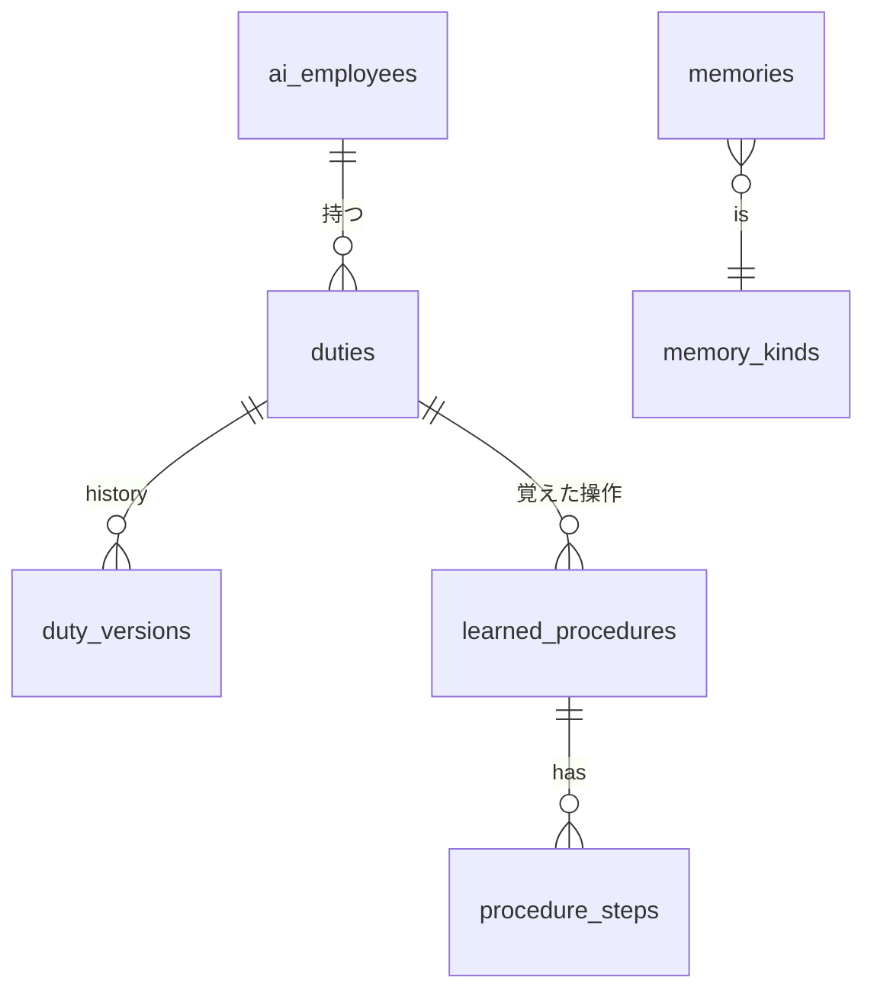

| テーブル | 主な列 | 備考 |
|---|---|---|
| `duties` | `<versioned>` / `ai_employee_id` / `name` / `definition_md` / `constraints jsonb` / `visibility_id` | ← **E9**。`visibility` で中身非公開の配布に対応 |
| `duty_versions` | `<common>` / `duty_id` / `version` / `snapshot jsonb` / `changed_by` / `change_reason` | **改訂履歴＝堀の実体**。会社のデータなので `<common>` |
| `learned_procedures` | `<scoped>` / `duty_id` / `target_service_id` / `status_id` / `run_count` / `avg_ms` / `fail_count` / `last_verified_at` | `status` = learning / mastered / needs_review |
| `procedure_steps` | `<common>` / `procedure_id` / `order_no` / `intent_ja` / `locator jsonb` / `is_variable` | **`intent_ja` が顧客に見える日本語**。`locator` は隠す |
| `memory_kinds` | `key` / `label` | **マスタ**（rule / preference / example） |
| `memories` | `<scoped>` / `kind_id` / `owner_member_id` / `title` / `body` / `confidence numeric(3,2)` / `source_type_id` / `source_ref_id` / `approved_by` / `approved_at` / **`digest_id`**（どの朝のまとめで入ったか ← D-105.2）/ **`superseded_by`**（整理で置き換えた先。前は残して戻せる ← D-105.5） | `kind` の rule＝**決まり（上の層ほど強い）**・preference／example＝**好み・やり方（本人に近い層ほど強い）**（D-105.8）。個人の範囲は自分のAI が自動で入れる（D-105.5）。本文に **PGroonga** の索引。意味の検索用のベクトルは `search_embeddings` に持つ（D-098.10） |
| **`memory_digests`** | `<common>` / `member_id` / `from_on date` / `to_on date` / `conversation_count int` / `state_id`（running／done／failed）/ `result jsonb`（覚えた／まとめた〔前と後〕／上げる候補／捨てた）/ `bridge_job_id` / `started_at` / `finished_at` | **★新設（D-105.2・D-105.3・D-105.4）。本人だけが読む。**記憶のまとめ。毎朝本人が「今日」で押して始める（時間で勝手に動かさない）。押さない日は溜まり、次に押したときに `from_on`〜`to_on` をまとめる。読むのは会話（`incognito` を除く）と、その日の承認・差し戻し |
| **`memory_proposals`** | `<scoped>` / `memory_id`（送った人の個人の記憶）/ `target_scope_id`（上げ先の層）/ `proposer_member_id` / `reviewer_member_id` / `state_id`（sent／accepted／returned）/ `conflict_group_id`（同じことへの食い違う提案の束）/ `evidence jsonb`（誰のどの会話から）/ `decided_at` | **★新設（D-105.6・D-105.9）。**上げる候補。上げ先は自分のAI が選び、本人が変えて送る。OK までは送った人の個人の記憶として効く。確認者がいない層は 1 つ上の層へ、最後は会社の代表（D-105.6）。決まったら束の全員に知らせる |
| `embedding_models` | `key` / `label` / `dim int` / `state_id`（active ／ building ／ retired）/ `artifact_url` / `sha256` | **段階 1 は作らない**（入れる境を越えたら・D-099.2）。**マスタ（運営）**。検索用のベクトルを作るモデル。使用中は 1 つ。替えるときは building で足し、そろったら active に切り替えて古いものを retired（D-098.4・D-098.5・D-099.4・D-099.6） |
| `search_embeddings` | `<scoped>` / `target_type_id`（memories ／ ledger_records ／ audit_events）/ `target_id` / `model_id` / `chunk_no` / `content_hash` / `embedding vector` | **段階 1 は作らない**（入れる境を越えたら・D-099.2）。**検索用のベクトル**（D-098.4）。作るのは本人の PC（Bridge）。PC が無い会社だけ段階 2 のサーバーで同じモデル（D-099.3）。次元はモデルごと（`vector` に次元を付けず、モデルごとに `(embedding::vector(dim))` の HNSW 部分索引）。本文が直されたら `content_hash` が変わった行だけ作り直す（D-098.6）。見えるかは元の行の行レベルの制御で決まる（D-098.3） |

---

## 5. 実行・統制（8）

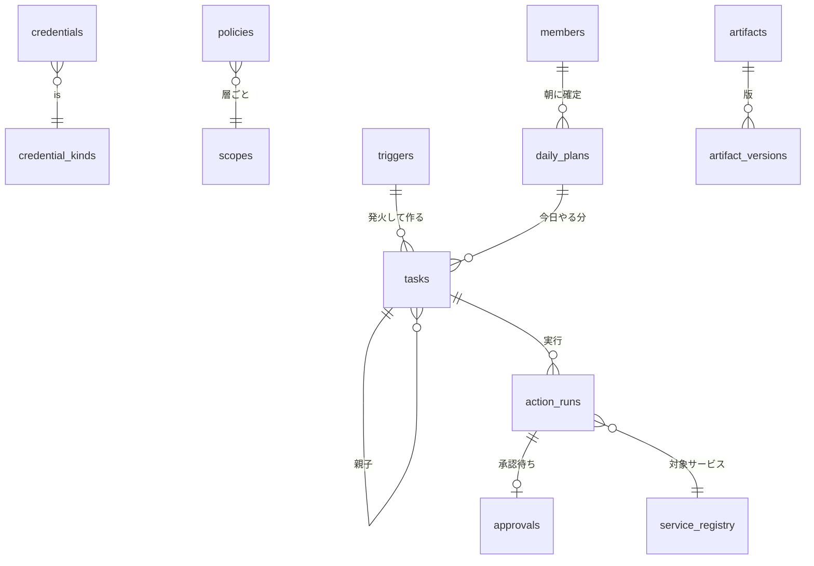

| テーブル | 主な列 | 備考 |
|---|---|---|
| `tasks` | `<scoped>` / **`parent_task_id`**（親タスク。null＝親無し。親の行に ▸ と「終わった数／全部」、親の中身に子の一覧。子は自分の中身を持つ ← D-072.12）/ `goal_id`（**null 可＝行き先のないタスク**）/ `measure_id` / `assignee_member_id`（人でも AI社員でも）/ `status_id` / `due_on` / `title` / **`origin_id`**（人／自分のAI／AI社員／台帳の段階）/ **`goal_changed_at`**（目標が改訂された印）/ **`next_action`**（次の一手・1 行）/ **`estimate_minutes`** / `actual_minutes` / **`planned_for date`**（朝の計画に入れた日）/ **`blocked_reason_id`**（返事待ち／承認待ち／PC停止／AI社員停止）/ `blocked_since` | `status` は **今日／あとで／詰まっている／終わった の 4 つだけ**（優先度フラグは持たない）。詰まっているは理由必須（D-068） | **人間にも AI にも同じ形**。`goal_id` が null のものは赤で出す（D-061） |
| **`task_handovers`** | `<common>` / `task_id` / `from_member_id` / `to_member_id` / `mode_id`（合意／指示）/ `agreement_status_id` / `reason` | ★新設。引き継いでもらう（push）も引き継ぐ（pull）もここ（画面の言葉は D-068）。**`tasks.goal_id` は変えない**（誰の目標かは変わらない） |
| **`daily_plans`** | `<common>` / `member_id` / `plan_date` / `capacity_minutes`（使える時間）/ `committed_at`（朝の確定）/ `closed_at`（夕方の整理）/ `carry_over jsonb`（残りをどう振り分けたか） | ★新設（D-068）。1 人 1 日 1 行。見込みの合計は `tasks.estimate_minutes` から集計 |
| `triggers` | `<scoped>` / `kind_id` / `cron_expr` / `timezone` / `on_missed_id` / `ttl_minutes` / `enabled` | `on_missed` = catch_up / latest_only / skip ← **E6** |
| `policies` | `<scoped>` / `subject_kind_id` / `action_kind_id` / `mode_id` / `params jsonb` / `is_locked` | `mode` = auto / approve / off。`is_locked` ＝ **運営の安全ルール（上書き不可）** ← **E8** |
| `approvals` | `<scoped>` / `action_run_id` / `requested_by` / `approver_member_id` / `status_id` / `resolved_at` / `note` | **すべての提案の入口** |
| `action_runs` | `<scoped>` / `task_id` / `action_kind_id` / **`choke_point_id`** / `service_id` / `procedure_id` / `status_id`（running／done／stopped／cancelled） / `started_at` / `finished_at` / `tokens_in` / `tokens_out` / `cost` / `error_summary`（止まった理由） / **`ai_employee_id`** / **`duty_id`**（どのAI社員がどの担当業務を ← D-116.4） / **`mode_id`**（test＝外に出ない／live ← D-028.2） / **`bridge_job_id`**（本人の PC で動いた仕事。成果物は artifacts.source_job_id で結ぶ ← D-121.2） / **`taken_over_at`**（止まった・動いている実行を担当者が自分で進めることにした時刻。止まった帯を引っ込める印。止まった理由の文は書き換えない ← D-151.17・K-485） | **`choke_point_id` を記録**（どの関門を通ったか） |
| `service_registry` | `<common>` / `name` / `domain` / `automation_verdict_id` / `notes` | `verdict` = api / allowed / unspecified / **forbidden** / **bank**。forbidden と bank の `domain` は、仕事を渡すたびに Bridge が本人の Claude Code に「使わない道具」とフックの一覧として渡す（D-107.1〜D-107.3）。見抜けない形は `notes` に書く（D-107.6） |
| `credential_kinds` | `key` / `label` | **マスタ**（password_totp / oauth2 / api_key / basic / email_otp / saml）← **E15** |
| `credentials` | `<scoped>` / **`name`**（名前で管理 ← D-125.148。英大文字で始まり英大文字・数字・_ で 64 文字まで）/ **`description`** / **`layer`**（workspace ／ personal ← D-125.149）/ `service_id` / **`service_name`**（本人が入れたサービス名 ← D-108.4）/ **`service_domain`**（宛先 ← D-108.4）/ `kind_id`（＋ llm_api_key・D-083.3）/ `provider_id`（anthropic ／ openai ／ google）/ **`vault_ref`** / `owner_member_id` / `revoked_at` | **実体は持たない。vault の参照 ID のみ**。一覧は契約の口 `listCredentials`（名前と使い方だけ・K-351）。前の一覧 `app.my_credentials`（サービス名・台帳の可否・状態だけ・D-108.3）は前の道すじを消すまで残る。名前の一意：ワークスペースは会社の中で 1 つ・個人は持ち主の中で 1 つ（消した物・失効した物は数えない）。守り：個人の物は持ち主だけが読む・書く／ワークスペースの物は同じ会社の人が読み、書くのは `credentials` のワークスペース全体の edit を持つ人だけ（D-128.57 ①） |

---

## 6. 会話・成果物・証跡（4）

| テーブル | 主な列 | 備考 |
|---|---|---|
| `conversations` | `<scoped>` / `title` / `participant_member_ids uuid[]` / **`area`**（領域＝営業／経理／会社全体…）/ **`subject_type` + `subject_id`**（対象＝案件・目標・施策・タスク）/ **`parent_conversation_id`**（流れ＝分岐元）/ **`agent_session_id`**（本人の Claude Code の続きの id。文脈そのものは Claude Code が持ち、ここは対応だけ ← D-090.1）/ `branched_from_message_id`（ここから分岐 ← D-090.3）/ `owner_member_id` / `closed_at`（「新しい会話」で閉じる ← D-062）/ **`title_auto bool`**（名前を自分のAIが付けたか。人が直したら false ← D-104.1）/ **`starred_at`**（星 ← D-104.1）/ **`incognito bool`**（記憶に残さない会話＝毎朝のまとめから外す ← D-104.1）/ **`last_read_at`**（見ていない間の返事の印 ← D-104.18）/ `deleted_at`（消す） | 人↔AI・人↔人・AI↔AI を区別しない。**会話は人が「新しく話す」で分け、一覧から戻る（D-104.1）。1 会話＝本人の Claude Code の 1 セッション**。一覧の探すは `title` と `messages.body` の PGroonga。領域・対象の列は残すが一覧の整理には使わない（D-062.5 を D-104.1 で改めた）。Bridge 経路の文脈は二重に持たない（← D-090.1） |
| **`bridge_jobs`** | `<scoped>` / `member_id` / `conversation_id` / `state_id`（`bridge_job_states`）/ `prompt` / `agent_session_id` / `result` / **`partial`**（書きながら出る返事の途中。終わると `result` と同じになる ← D-104.8）/ `stopped_reason`（そのまま人に見せる文）/ **`permission_mode`**（manual／acceptEdits／auto／plan／bypassPermissions。全部許可は本人が選んだときだけ ← D-104.14）/ **`model`** / **`effort`**（本人のサブスクで使えるものだけ ← D-104.13）/ **`tools text[]`**（使うもの＝スキル・道具 ← D-104.13）/ **`attachment_ids uuid[]`**（付けた資料 ← D-104.11）/ **`steer_seq`**（止めずに送った文の数 ← D-104.9）/ **`tool_token_hash`**（Kaname の道具の鍵のハッシュ。仕事を渡すたびに作り、その仕事が動いている間だけ効く ← D-110.3）/ **`browser`**（その仕事だけのブラウザの指定。もう一度確かめる仕事は chrome。空なら会話の仕事は端末の選択・それ以外は使わない ← D-120.1・D-120.3）/ `started_at` / `finished_at` | **★新設（D-090.2・D-090.4・D-090.5）。**自分のAIに言ったことの並び。Bridge が 1 件ずつ取り（`app.bridge_take_job`・`for update skip locked`）、結末を返す（`app.bridge_finish_job`）。**止まったものは `stopped` のまま残り、自動で再開しない。**続けるかは次に送る文で決まる（D-104.15。ボタンで選ばせない）。**動いている間に送った文は `queued` の行として順番待ちに並び、取り消すと `cancelled`（D-104.9）。止めずに直す文は `bridge_job_events(kind=steer)` で動いている仕事に渡す** |
| `bridge_job_states` | `key`（PK）/ `label` | **マスタ**（`<common>`）。待っている／動いている／終わった／止まった（人が選ぶまでそのまま）／やめた（D-090.4）／**確認待ち**（本人が許可するまで・D-093.3） |
| **`bridge_job_events`** | `<scoped>` / `member_id` / `job_id`（`bridge_jobs`）/ `kind`（init／progress／ask／answer／tool／usage／**status**〔「〇〇を調べています」の 1 行〕／**plan**〔手順のチェックリスト〕／**steer**〔止めずに直す文〕／**stop**〔止める〕／**question**〔自分のAIからの問い合わせ：問い・選択肢・見本・複数〕／**limit**〔サブスクの使用量〕 ← D-104.7・D-104.8・D-104.9・D-104.16）/ `seq` / `request_id`（確認とその答えを結ぶ）/ `payload jsonb`（progress: text ／ ask: tool・input・summary ／ answer: allow・scope（once／always）・note ／ tool: name・target・ok・ms ／ usage: turns・duration_ms・input_tokens・output_tokens・cost_usd） | **★新設（D-093.2・D-093.3・D-093.4・D-093.7・D-093.8）。**公式 CLI の 1 行 1 イベントのうち、人に見せるものと本人の答え。`init` で会話の id を先に覚える（落ちても続きから）。確認の答えは `audit_events`（`bridge.tool_allowed`／`tool_denied`・関門 C5）にも出す。書くのは `app.bridge_progress` / `app.bridge_ask` / `app.agent_answer`、読むのは `app.agent_state`。**仕事の記録（D-100.1・D-100.2）**：道具の呼び出しと使った量を残す。**中身の全文（ファイルの中身・道具の返り値）は残さない**（D-100.3）。会話に出すのは progress だけ |
| **`permission_rules`** | `<scoped>` / `member_id` / `tool` / `target_pattern` / `decision_id`（allow／deny）/ `bridge_job_event_id`（「いつも」を押した問い）/ `revoked_at` | **★新設（D-104.14）。本人だけが読む。**許可の決まり。本人が「いつも」にした道具と対象。Bridge が仕事を渡すときに Claude Code の許可の一覧として渡す。設定で一覧・取り消し。選んでいるモードは `members.agent_permission_mode`。**全部許可でも、サービス台帳で禁止・銀行のドメインは許可の一覧より強く止める（D-107.2）** |
| **`agent_usage_snapshots`** | `<common>` / `member_id` / `window_id`（five_hour／week）/ `utilization numeric(5,2)` / `resets_at` / `observed_at` | **★新設（D-104.16）。本人だけが読む。**自分のAIの使用量。Bridge が Claude Code から受けた使用量を最新だけ残す（会員ごと・枠ごとに 1 行を上書き）。近い・達したら会話に案内 |
| `messages` | `<common>` / `conversation_id` / `sender_member_id` / `body` / `attachments jsonb` / `action_run_id` / **`kind`**（text／question／approval／receipt／status／error）/ **`options jsonb`**（自分のAIからの問い合わせ：問い 1〜4・選択肢・説明・推奨・見本・複数・「その他」← D-104.7。「あとで」は置かない）/ **`confidence`**（high／check）/ **`citations jsonb`**（台帳行・記憶・証跡の参照）/ **`parent_message_id`**（直して送り直した元 ← D-104.17）/ **`quote jsonb`**（一部を選んで引用して続けた元 ← D-104.17）/ **`work jsonb`**（畳んだ作業の 1 行：操作の数・時間 ← D-104.8）/ **`send_state`**（送れなかった＝failed ← D-104.15）/ **`transcript_uuid`**（本人の PC の Claude Code の記録の id。会話の中で一意。自分のAI の文の写し ← D-112）/ **`undo_action_run_id`**（取り消し先）/ `read_at` | **会話の部品 1 組を列で持つ ← D-066**。受領・取り消しは `action_runs` / `audit_events` の実体があるときだけ描く |
| `artifacts` | `<scoped>` / `task_id` / `format_id` / `storage_ref` / `template_id` / `approved_by` / **`source_message_id`**（会話の返事から書き出した ← D-104.17）/ **`title`**（返事の最初の見出しか最初の行から付き、直せる ← D-106.1）/ **`owner_member_id`**（書き出した人 ← D-106.8）/ **`current_version int`**（今の版 ← D-106.3）/ **`source_conversation_id`**（どの会話から ← D-106.2）/ **`source_job_id`**（自分のAI が道具 artifact_put で渡した仕事。結末が書かれたら返事に結ぶ ← D-121.2） | `format` = pdf / pptx / xlsx / docx / md / html / csv ← **E13**。会話から書き出した資料も成果物に入る（手元に落とすのは自由、外に出すときだけ承認）。`storage_ref` は今の版の置き場（版の表と同じ値）。**直す・戻す・読むは `app.artifact_*` の関数を通す**（生の select をしない） |
| **`artifact_versions`** | `<scoped>` / `artifact_id` / `version int` / `storage_ref` / `size_bytes bigint` / `owner_member_id`（その版を作った人）/ `reverted_from int`（戻したときの元の版）/ `note` | **★新設（D-106.3・D-106.4）。**直すと 1 行増える。戻すのも新しい行（消さない）。`(artifact_id, version)` は一意。中身は置き場（関門 C4） |
| **`audit_events`** | `<common>` / `actor_member_id` / `actor_role` / `action` / `target_type` / `target_id` / `choke_point_id` / `payload jsonb` / `occurred_at` | **追記専用**（UPDATE / DELETE を許可しない）。パーティション |

---

## 7. マスタ（enum の代わり・8）

`member_kinds` ／ `goal_kinds` ／ `memory_kinds` ／ `credential_kinds` ／
`ledger_kinds` ／ `view_kinds` ／ `action_kinds` ／ `status_masters`（各種ステータスを 1 テーブルに集約 ＋ `domain` 列で区別）／ `session_kinds`（web / bridge / api）／ `revoke_reasons`（失効の理由）

| テーブル | 主な列 | 備考 |
|---|---|---|
| `session_kinds` | `key` / `label` | **マスタ**（web / bridge / api。sessions.kind_id） |
| `revoke_reasons` | `key` / `label` | **マスタ**（logout / password_changed / permission_changed / member_left / suspended / tenant_closed / invite_revoked / expired / admin。sessions.revoke_reason_id） |

**Postgres enum を使わない理由**：値の追加が migration ＋ 型再生成 ＋ 全分岐の見直しになるため。

---

## 8. 設計上の注記

| # | 注記 |
|---|---|
| 1 | **全テーブルに RLS を定義する。** RLS 未定義のテーブルは CI（ゲート 4）で作れない |
| 2 | RLS は **`current_setting('app.tenant_id')`** ベース。`auth.uid()` は CI（ゲート 5）で禁止 |
| 3 | `audit_events` は**追記専用**。UPDATE / DELETE 権限を与えない |
| 4 | `credentials` は**実体を持たない**。vault の参照 ID のみ。AI に渡すのも参照 ID |
| 5 | `ledger_records.data` への動的クエリは**許可リスト方式**。文字列連結は CI（ゲート 10）で禁止 |
| 6 | **段階 1 の「探す」は自分のAI が PGroonga（台帳・記憶・証跡の本文）で言い換えを広げて探し、読んで選ぶ。ベクトルは作らない**（D-099.1）。件数と探す時間が境を越えたら `search_embeddings`（モデルごとの HNSW 部分索引・次元はモデルで決まる）を入れる（D-099.2・D-098.4・D-098.5） |
| 6b | **目標の単位は運営が列挙しない。** `units` は `<scoped>` なので、運営／会社／部署／個人のどの層でも作れる。目標をどう分解するかは**目標設定スキルが決め、Kaname はその出力を受け取る器**（決定ログ §30 構築メタスキル「目標の分解」） |
| 6c | **`rollup_kind` は「足す／変換して足す／足さない」の3つで論理的に尽きている**（列挙ではなく導出）。増えるのは `rollup_spec` の中身であって、型ではない |
| 7 | ~~段階 2 以降で追加：plans / plan_limits / usage_meters / invoices / notifications / subscriptions / error_events~~ → **D-069・D-075・D-076 で段階 1 に繰り上げ（§12）。**段階 2 に残るのはカード決済（`payments.method` の追加と関門 C7 の決済プロバイダ）だけ |
| 8 | `scopes` は自己参照の木。**一人社長なら 2 層（運営 ＋ 個人）で成立**する。層の名前は `layers`（会社ごと）から引き、「部署」を固定しない（D-073.4） |
| 9 | **運営は既定で顧客のデータを読めない。**運営ロールの RLS は `support_access_grants` の有効な行（中を見るの許可：理由つき・1 時間・見るだけ）があるときだけ許可し、したことは運営の証跡と相手のワークスペースの証跡の両方に書く（D-074.5 を D-125.128 で改め、D-128.68・D-128.108 で詰めた） |
| 10 | **口座状態の出来事（退会・停止・権限変更・パスワード変更・招待取消）は `sessions` を全行 revoked にする。**API・Bridge・共有リンク・Webhook はトークンの期限ではなく `sessions` を見る（G-14） |
| 11 | **`flow.json` の objects[] とこの文書のテーブルは機械で突き合わせる**（`scripts/ci/er_gate.py`）。オブジェクトに実体が無い＝決めたのに DB に無い |

---

## 9. 層と権限（D-073）（4）

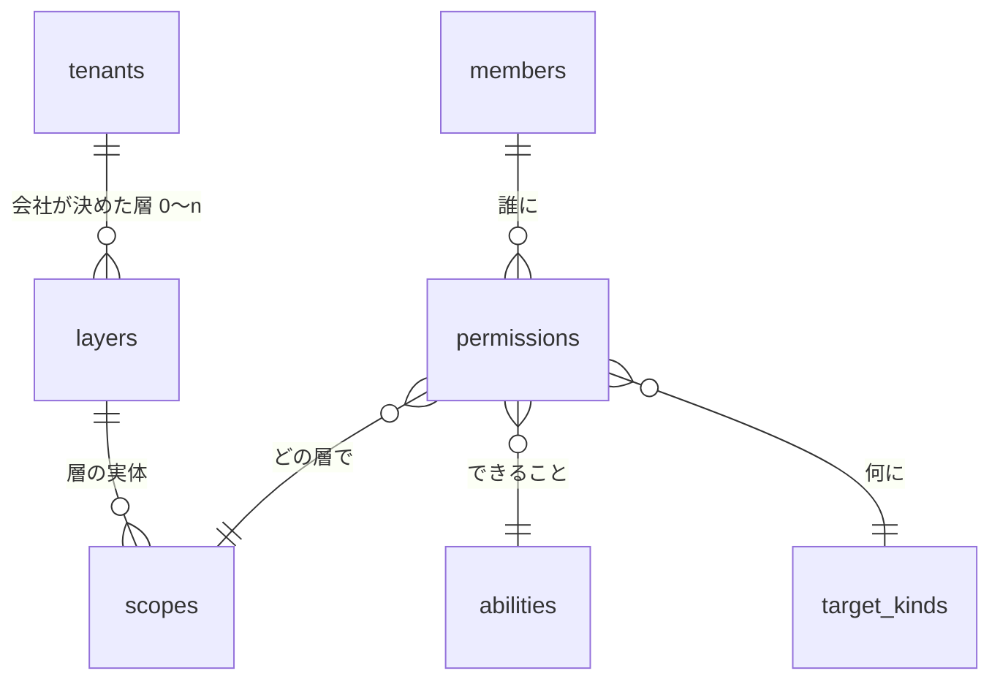

| テーブル | 主な列 | 備考 |
|---|---|---|
| **`layers`** | `<common>` / `key` / `label` / `order_no` | **★新設（D-073.4）。層は会社ごと。**運営／会社／個人は固定、その間の層（部署・事業…）は会社が 0〜n 個作る。`scopes.layer_id` が指す。画面に「部署」を固定名で書かない |
| **`target_kinds`** | `key` / `label` | **マスタ**（memory / rule / goal / duty / ledger / ai_employee / template / procedure / member / plan …＝権限の「何に」） |
| **`abilities`** | `key` / `label` | **マスタ**（view / edit / create / delete / allocate / approve / invite ＝「できること」） |
| **`permissions`** | `<common>` / `grantee_member_id` / `target_kind_id` / `scope_id` / `ability_id` / `granted_by` / `revoked_at` | **★新設（D-073.1〜D-073.3）。権限＝誰に×何に×どの層で×できること。**本人のもの（`owner_member_id = app.user_id` の個人の範囲）は権限なしで自由＝RLS の predicate `self_only` で表し、行を作らない。R3（担当者）・R4（閲覧のみ）も `abilities=view` の行で「見える」を持つ（見えないのが既定ではない） |

---

## 10. 口座状態の出来事・失効・サポートアクセス（D-074・D-076.13・G-14）（6）

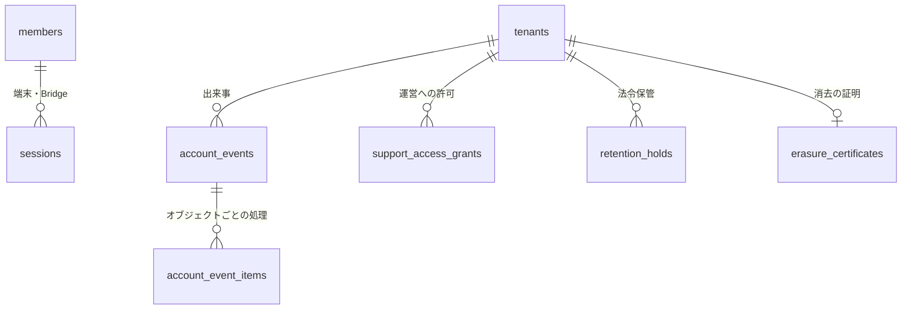

| テーブル | 主な列 | 備考 |
|---|---|---|
| **`account_events`** | `<common>` / `kind_id`（member_leave / company_close / suspend / permission_change / plan_change / layer_delete / staff_delete）/ `subject_type` / `subject_id` / `requested_by` / `status_id`（pending / resolving / done）/ `resolved_at` | **★新設（D-074.1・D-076.13）。**出来事 7 つの実体。画面の依存表（G16）はここから |
| **`account_event_items`** | `<common>` / `event_id` / `object_kind`（flow.json の objects 名）/ `disposition_id`（消える／残る／移る・戻る／止まる／即失効）/ `target_ref` / `decided_by` / `done_at` | **★新設。**オブジェクトごとの「何が起きるか」と引き継ぎ先の決定。全部 done になるまで出来事は終わらない（引き継ぎ先を決めるまで消せない） |
| **`sessions`** | `<common>` / `member_id` / `kind_id`（web / bridge / api）/ `auth_session_id`（Better Auth のセッション。失効の判定はこの表が正） / `device_label` / `ip_region` / `issued_at` / `last_seen_at` / `revoked_at` / `revoke_reason_id` / `device_token_hash`（PC の印の sha256・K-57） / `alive_at`（最初の生きている知らせ・D-090） / `bridge_version` / `machine_id`（この PC の印・D-128.174） | **★新設（D-076.1・G-14）。**端末の一覧。退会・停止・権限変更・パスワード変更で **全行を即 revoked** にし、API と Bridge はこの表を見て拒否する（発行済みトークンの有効期限に頼らない） / **`health`** / **`health_at`**（Bridge が返した自己診断。Bridge の中で完結させない ← D-090.7）。`last_seen_at` は生存の知らせで動き、75 秒来なければ画面は「切れています」← D-090.8 / **`browser`**（chrome／dedicated／off。この端末で AI が使うブラウザ。Kaname が正本で、PC の画面か Bridge の窓で変える ← D-120.1） / **`country`**（国。配布先の印 x-vercel-ip-country）・**`device`**（ブラウザの種類／OS）・**`last_ip`**（記録だけ）。国か端末が変わったら閉じる・同じ国の中の IP の変化は security_events に記録だけ。操作が無い 12 時間・最長 7 日は画面のセッションだけ（Bridge は時間では切らない）← D-128.120・D-128.121 / Bridge の行（K-57・0089）：**`device_token_hash`**（PC の印 kpc_… の sha256。印そのものは持たない・一意）・**`alive_at`**（最初の生きている知らせが届いた時刻。届くまで「つながっています」と言わない ← D-090）・**`bridge_version`**・**`machine_id`**（同じ人の同じ印でつなぎ直したときだけ前の行を切る。古い Bridge は空 ← D-128.174） / **`mfa_pending`**（付けるまで進めない印。パスキーも 2 段階も無い人の画面のセッションに立て、入り方がそろったら全部のワークスペースで下ろす。Bridge には立てない ← D-128.141・K-308・0113） |
| **`support_access_grants`** | `<common>` / `granted_by_member_id` / `scope jsonb`（構成／手順／証跡 …）/ `expires_at` / `revoked_at` / `ops_member_id` | **★新設（D-074.5・D-125.128 で改めた）。**運営は既定で顧客データを見られない。規約で先に許可をもらい（D-125.128）、「中を見る」を持つ運営の人が理由を書いて開いたときだけ、この行（1 時間・見るだけ・D-128.68）を根拠に読める。したことは運営側 `ops_audit_events` と会社側 `audit_events` の両方に残る（D-128.108） |
| **`retention_holds`** | `<common>` / `record_type` / `record_ref` / `retain_until` / `legal_basis` | **★新設（D-074.3）。**退会後も法令で残す記録（請求の記録 7 年 等）。消去バッチはこの表の行を除外する |
| **`erasure_certificates`** | `<common>` / `issued_at` / `content_hash` / `sent_to` / `storage_ref` | **★新設（D-074.3）。**猶予（30 日・復元可）の後の完全消去で自動生成し、会社の代表に送る |

---

## 11. 運営（マスタの配布・会社ごとの配布・審査・運営の証跡）（D-073.7・D-074.4・D-076.5・D-076.10・D-077）（9）

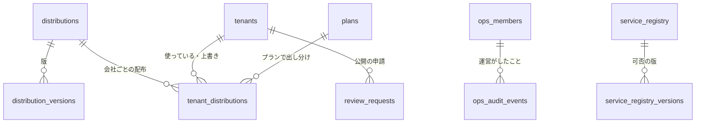

| テーブル | 主な列 | 備考 |
|---|---|---|
| **`distributions`** | `<common>`（tenant_id＝運営）/ `kind_id`（ai_employee / duty / rule / template / goal_skill）/ `key` / `name` / `current_version` / `plan_ids uuid[]` / `is_locked` | **★新設（D-037・D-076.10・D-077.4）。運営配布物のマスタ。**`ai_employees.provisioning_id` はここを指す。目標スキル（D-063）も配布物の一種。`is_locked`＝上書き不可の安全ルール |
| **`distribution_versions`** | `distribution_id` / `version` / `snapshot jsonb` / `released_at` / `released_by` / `change_reason` | 版。会社側は版を上げるまで変わらない（D-076.10） |
| **`tenant_distributions`** | `<common>` / `distribution_id` / `version_in_use` / `enabled` / `override jsonb`（会社が足した個人ルール等）/ `disabled_by` | **★新設（D-077.6）。**会社の詳細「配布したもの」＝この会社が使っている配布物・版・上書き。運営はマスタを直し、ここは 1 社への配布の状態 |
| **`service_registry_versions`** | `<common>`（tenant_id＝運営）/ `service_id` / `version` / `automation_verdict_id` / `reason` / `released_at` | **★新設（D-076.5）。**サービス台帳の可否は版で持ち、全社に効く。禁止に変えたら使っている会社に自動でお知らせ |
| **`service_requests`** | `<common>` / `service_name` / `url` / `requested_by` / `verdict_id` / `decided_at` | **★新設（D-076.5）。**会社からの「このサービスは触れるか」の申請 |
| **`review_requests`** | `<common>` / `subject_type`（template / duty）/ `subject_id` / `anonymization_check jsonb` / `status_id`（pending / approved / rejected / returned）/ `reviewer_ops_member_id` / `decided_at` / `reason` | **★新設（D-027・D-074.4・D-077.3）。**会社が明示的に公開したものの審査。承認・却下は会社の詳細の「審査」で行う。公開時の出どころは業種名だけ |
| **`ops_members`** | `<common>`（tenant_id＝運営）/ `member_id` / `ops_role_id`（support / billing / catalog / admin）/ `revoked_at` | **★新設（D-073.7・D-074.4）。**運営メンバーと権限。運営の権限も 誰に×何に×できること |
| **`ops_audit_events`** | `<common>`（tenant_id＝運営）/ `ops_member_id` / `target_tenant_id` / `action` / `target_type` / `target_id` / `grant_id` / `payload jsonb` / `occurred_at` | **★新設（D-074.4・D-077.7）。追記専用。**運営が「どの会社に何をしたか」。同じ行を対象会社の `audit_events` にも書く（顧客が自分の証跡で見られる） |
| **`security_events`** | `<common>` / `kind_id`（login_failed / key_revoked / suspicious_connection / mfa_reset / ip_changed（同じ国の中で IP だけ変わった・記録だけ）/ step_up / step_up_failed（本人確認の取り直し）← D-128.120・K-19・K-20）/ `member_id` / `ip_region` / `detail jsonb` / `occurred_at` | **★新設（D-075.6）。追記専用。**セキュリティの出来事。会社側「できること・できないこと」と運営側「運営の証跡」の両方から読む |

---

## 12. 運営と顧客の間で往復するもの・自分で整えるもの（D-069・D-075・D-076）（14）

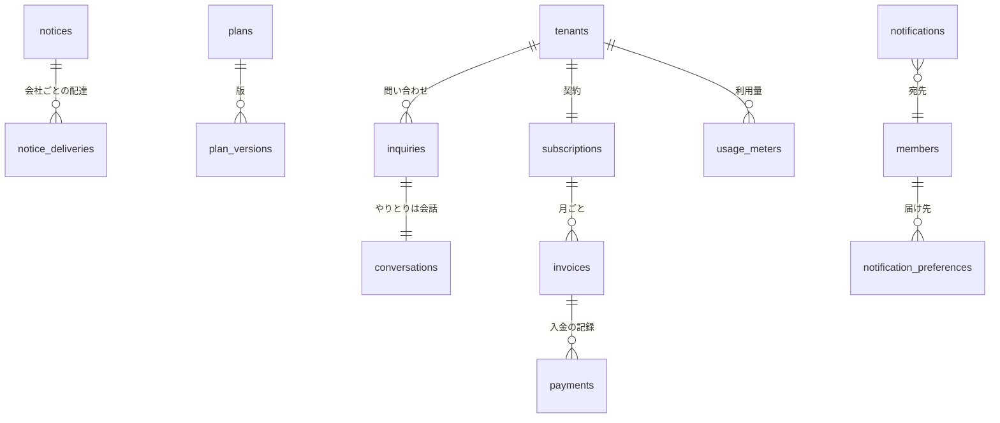

| テーブル | 主な列 | 備考 |
|---|---|---|
| **`inquiries`** | `<common>` / `opened_by_member_id` / `kind_id`（howto / stuck / billing / request / other）/ `status_id`（waiting / answered / resolved）/ `conversation_id` / `assignee_ops_member_id` / `ai_first_answered_at` | **★新設（D-075.1・D-077.1）。**まず自分のAIが答え、解けなければ運営へ。やりとりの本文は `conversations` / `messages`（同じ部品）。運営に届くのは構成と型だけで台帳の中身は送らない |
| **`notices`** | `<common>`（tenant_id＝運営）/ `kind_id`（release / incident / maintenance / rule_version / individual）/ `title` / `body` / `target_plan_ids uuid[]` / `target_tenant_id` / `publish_at` / `published_by` | **★新設（D-075.2・D-077.8）。**全体のお知らせも会社ごとのお知らせも同じ表（`target_tenant_id` の有無） |
| **`notice_deliveries`** | `<common>` / `notice_id` / `member_id` / `delivered_at` / `read_at` | 会社側「お知らせ」の既読 |
| **`status_incidents`** | `<common>`（tenant_id＝運営）/ `component_id`（kaname / bridge / server_route / external_service）/ `service_id` / `state_id` / `started_at` / `resolved_at` / `note` | **★新設（D-075.2・D-076.9）。**稼働状況。会社側は自分の Bridge・経路の状態を `sessions` と `action_runs` から足して表示 |
| **`notification_preferences`** | `<common>` / `member_id` / `event_kind_id`（approval_waiting / ai_stopped / sole_approver / notice_incident / notice_release / inquiry_answered）/ `channel_id`（in_app / email / push）/ `enabled` | **★新設（D-075.3・D-043）。**通知の届け先。関門 C6 が宛先解決に読む |
| **`notifications`** | `<common>` / `member_id` / `channel_id` / `event_kind_id` / `payload jsonb` / `dedupe_key` / `sent_at` / `failed_at` / **`read_at`**（読んだ時刻・空＝未読 ← D-151.2。鈴が読むのはこの列だけで、`sent_at`・`failed_at` は段 9 のメールの印のまま）/ `retry_count` | **★新設（D-043・C6）。**送出の outbox。重複抑止・再送・証跡は関門 C6 の責務。鈴の一覧は契約の口 `listNotifications`（自分宛て・未読は全部・読んだものは読んだ時刻から 30 日・K-461）。**守り：読むのも書くのも自分宛てだけ**（`notifications_self_read`・`notifications_self_only_write`・D-151.3。権限のある人も他人宛ての行に触れない。書き手は security definer の関数で守りの外）。索引：未読だけ（`notifications_inbox_unread_idx`）と新しい順（`notifications_inbox_idx`） |
| **`plans`** | `<common>`（tenant_id＝運営）/ `key`（entry / standard / pro）/ `name` / `price_monthly` / `limits jsonb`（AI社員・担当業務・自律実行／日・人・層）/ `current_version` | **★新設（D-076.6・D-077.5）。マスタ。**「配るもの」の画面で版管理。段階 2 の注記（注 7）から段階 1 に繰り上げ |
| **`plan_versions`** | `plan_id` / `version` / `snapshot jsonb` / `released_at` | 価格・上限の版 |
| **`subscriptions`** | `<common>` / `plan_id` / `status_id`（active / suspended / closing / closed）/ `started_at` / `suspended_at` / `ended_at` / `billing_contact jsonb` / `payment_method_id`（段階 2・D-082.1）/ `stripe_customer_ref` / `stripe_subscription_ref`（Stripe の写し・D-082.3）| **★新設（D-075.4）。**会社の契約。休止（D-076.13）は `status=suspended`。請求先は会社の設定（D-076.2） |
| **`plan_change_requests`** | `<common>` / `from_plan_id` / `to_plan_id` / `requested_by` / `status_id` / `dependencies_event_id` / `decided_by_ops_member_id` / `decided_at` | 下げるときは `account_events(kind=plan_change)` を作って依存を片づけてから |
| **`usage_meters`** | `<common>` / `meter_key`（ai_employees / duties / autonomous_runs_day / members / layers）/ `period_start` / `value` / `limit_value` | **★新設（D-075.5）。**上限に近いものを自分のAIが先に言う。上限超過は止まるだけで消えない |
| **`invoices`** | `<common>` / `subscription_id` / `period_start` / `period_end` / `amount` / `issued_at` / `due_on` / `status_id`（issued / paid / overdue / void）/ `pdf_ref` / `stripe_invoice_ref` / `hosted_url`（Stripe の請求書・領収書 PDF・D-082.6）| **★新設（D-075.4）。段階 1 は請求書払い。**カードは段階 2（D-002）で `payments.method` が増えるだけ |
| **`payments`** | `<common>` / `invoice_id` / `paid_on` / `amount` / `method_id`（bank_transfer ／ card）/ `recorded_by_ops_member_id` / `stripe_payment_ref`（カードは写しで自動・D-082.3）| 入金の記録は運営が会社の詳細で行う（D-077.1）。未収 30 日超で休止の案内 |
| **`error_events`** | `<common>` / `error_code`（`07_qa/test-specs/errors.json` の ID）/ `member_id` / `screen_id` / `context jsonb` / `shown_at` / `next_action_taken_at` | **★新設（D-069.3・D-069.4）。**エラー一覧の 1 件が「出た」記録。文言と次の一手は errors.json が正本 |

---

## 13. 取り込み・正規連携・招待・持ち出し・添付（D-076.3・D-076.4・D-026・D-042）（5）

| テーブル | 主な列 | 備考 |
|---|---|---|
| **`imports`** | `<scoped>` / `file_ref` / `detected_kind_id`（ledger_rows / template / procedure / memory）/ `proposal jsonb` / `status_id`（read / confirmed / applied / discarded）/ `applied_at` / `applied_by` | **★新設（D-076.3・D-025）。**形式を問わず受け取り自分のAIが読む。本番の台帳には人が押してから入る（3 経路の (3)） |
| **`integrations`** | `<scoped>` / `service_id` / `kind_id`（oauth2 / api_key）/ `credential_id`（vault 参照）/ `scopes text[]` / `status_id` / `connected_at` / `revoked_at` | **★新設（D-076.4・D-041）。**正規連携（freee / Google …）。資格情報は `credentials` 経由で vault 参照だけ |
| **`invitations`** | `<common>` / `email` / `scope_id` / `role_id` / `permission_preset jsonb` / `token_hash` / `expires_at` / `accepted_member_id` / `revoked_at` / **`message`**（招いた人のひとこと・500 文字まで・空可） / **`resend_requested_at`**（最後に送り直しを頼まれて全員に届いた時刻・空可・1 日 1 回の判定・K-334） | **★新設（D-026・D-037）。**招待。取り消しで `token_hash` は即無効（G-14） / 下見は DB の関数 `app.invitation_preview2`（読むだけ・状態は used ＞ revoked ＞ expired ＞ ok）← D-128.62・D-128.63・K-331・0114 / 送り直しの頼みは `app.invitation_resend_targets`（宛て＝招いた人か管理者）・`app.invitation_resend_record`（知らせの行・前の回に送れなかった宛てだけを送り直す）・`app.invitation_resend_mark`（届いた／届かなかった印）・`app.invitation_resend_stamp`（全員に届いたときだけ頼んだ時刻）。どれもトークンで引く ← D-128.63・K-334・20261119051731 |
| **`pending_signup`** | `email`（主キー）/ `name` / `company_name` / `pw_iv` `pw_tag` `pw_data`（鍵で包んだパスワード）/ `token_hash` / `expires_at` / `sent_at` / `send_error` / `consumed_at` | **★新設（D-088.2）。**保留の申し込み。「はじめる」ではここに 1 行置くだけで、会社も利用者も作らない。リンクを押した時点で作る。会社のデータではない（まだ会社が無い）ので `public` ではなく スキーマ `kaname_auth` に置き、触れるのは認証の接続だけ。平文のパスワードは持たず 30 分で失効し、確認が済んだら `consumed_at` を立てる（消すと「もう済んだ」と「期限切れ」が同じ見た目になる） |
| **`export_jobs`** | `<common>` / `requested_by` / `kind_id`（all / audit / ledger / conversations）/ `storage_ref` / `status_id` / `expires_at` / `downloaded_at` | **★新設（D-042）。**持ち出し。関門 C4 を通る。ダウンロード URL は期限つき署名 |
| **`attachments`** | `<scoped>` / `owner_type`（message / task / record / inquiry）/ `owner_id` / `storage_ref` / `mime` / `size` / `name` / `uploaded_by` / `scanned_at` | **★新設。**添付の実体を 1 表に。`messages.attachments jsonb` は参照だけ持つ。**会話で付けた資料・画像（D-104.11）**もここ。実体は会社の置き場（関門 C4）で、Bridge は期限つきの署名 URL で受け取る（保存先の鍵は AI に見せない） |

---

## 14. スキル（運営の資産：構築・版・テスト・配布・装着）（D-078）（4）

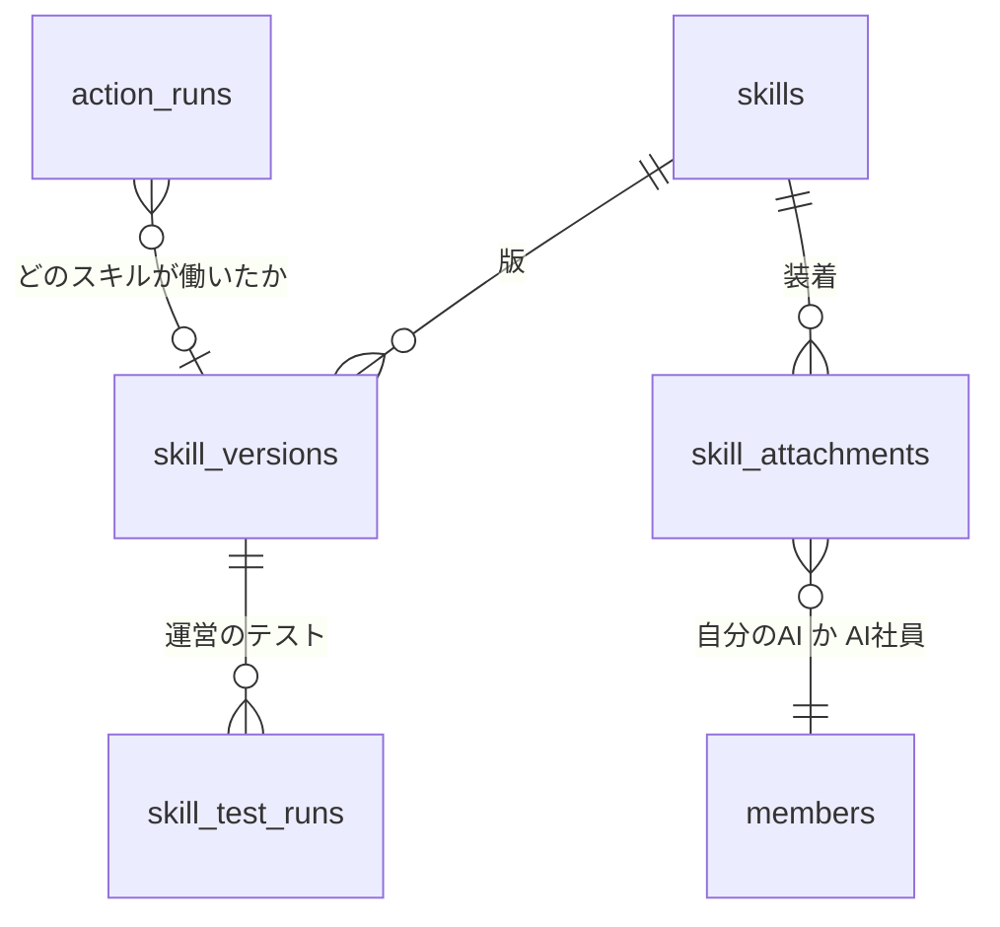

| テーブル | 主な列 | 備考 |
|---|---|---|
| **`skills`** | `<common>`（tenant_id＝運営）/ `kind_id`（meta / goal / duty）/ `key` / `name` / `purpose` / `current_version` / `plan_ids uuid[]` / `visibility_id`（name_only） | **★新設（D-078.1）。**構築メタスキル 7 種・目標スキル・業務スキルのマスタ。顧客には名前・目的・版だけ見える。`distributions(kind=goal_skill)` はここへ移す |
| **`skill_versions`** | `skill_id` / `version` / `package_ref`（C4）/ `changelog` / `tested_at` / `test_result jsonb` / `released_at` / `released_by` | **★新設（D-078.2）。**出す前に運営がテストで動かす。前の版に戻せる |
| **`skill_test_runs`** | `<common>`（tenant_id＝運営）/ `skill_version_id` / `ops_member_id` / `mode`（test）/ `started_at` / `finished_at` / `result jsonb` | テストは外に出ない（`action_runs.mode_id = test` と同じ規則） |
| **`skill_attachments`** | `<common>` / `skill_id` / `version_in_use` / `target_type`（clone / ai_employee）/ `target_id` / `enabled` / `disabled_by` / `attached_at` | **★新設（D-078.3・D-078.4）。**会社の詳細「配布したもの」と AI社員の 1 体「使えるスキル」はここを読む。会社の権限者が `enabled=false` にできる。AI社員を消す → 行が消える（D-078.7） |

`skill_versions.package_ref` は 10_skills/<skill>/ の一式（SKILL.md＋references＋evals）を C4 に置いた参照（D-080.1）。`skill_test_runs.result` は evals/scenarios.json の期待との突き合わせ（D-080.5）。`action_runs.skill_version_id`（任意）を足し、「どのスキルが働いたか」を証跡と AI社員の動きに出す（D-078.5）。`goals.skill_version_id`（任意）で「どのスキルで組んだか」（D-076.10・D-078.5）。

---

## 15. 段階 2 で足す表（D-082〜D-085）（7）

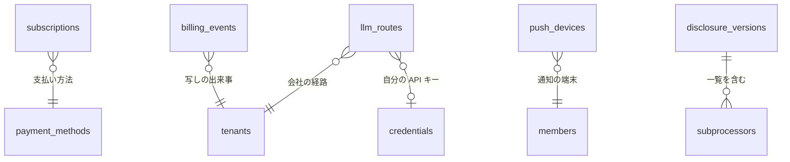

| テーブル | 主な列 | 備考 |
|---|---|---|
| **`payment_methods`** | `<common>` / `kind_id`（invoice ／ card）/ `stripe_customer_ref` / `brand` / `last4` / `expires_on` / `registered_at` | **★段階 2（D-082.1・D-082.2）。**会社が選んだ支払い方法。カードの実体は Stripe。番号は持たない |
| **`billing_events`** | `<common>` / `stripe_event_ref` / `kind` / `payload jsonb` / `received_at` / `processed_at` / `signature_ok` | **★段階 2（D-082.3・D-082.4）。**Stripe の webhook の写し。同じ出来事は二度処理しない（stripe_event_ref に unique）。失敗 → 猶予 → 休止の判定の元 |
| **`llm_routes`** | `<common>` / `default_kind_id`（bridge ／ byok ／ managed）/ `offline_kind_id` / `provider_id`（anthropic ／ openai ／ google）/ `credential_id`（vault 参照・任意）/ `managed_allowed_by_ops_member_id` / `managed_allowed_at` | **★段階 2（D-083.1・D-083.4・D-083.6）。**会社ごとの AI の経路。運営マネージドの許可は運営が書く |
| **`llm_capabilities`** | `key`（provider:capability）/ `label` / `provider_id` / `capability_id` / `supported` | **★段階 2（D-083.2・D-004）。マスタ。**3 社で揃えた能力表。揃わない能力はどの経路でも出さない |
| **`push_devices`** | `<common>` / `member_id` / `platform_id`（ios ／ android ／ desktop）/ `token_ref` / `app_version` / `last_seen_at` / `revoked_at` | **★段階 2（D-084.3）。**アプリのプッシュ通知の届け先。失効は即時（G-14） |
| **`disclosure_versions`** | `<common>`（tenant_id＝運営）/ `version` / `generated_at` / `content_hash` / `pdf_ref`（C4）/ `dpa_ref` / `released_by` / `notice_id` | **★段階 2（D-085.1・D-085.2）。**成果物から生成した開示資料の版。変わったらお知らせ |
| **`subprocessors`** | `<common>`（tenant_id＝運営）/ `name` / `purpose` / `region` / `data_kinds text[]` / `effective_from` / `announced_at` / `retired_at` | **★段階 2（D-085.2・D-042）。**顧客のデータを触る外部の会社。変更は事前通知 |

`llm_capabilities` は運営のマスタ（3 社 × 能力）。`llm_routes.provider_id` が byok のときは `credential_id`（kind=llm_api_key）が要る。`push_devices.token_ref` は関門 C8 の参照（token の実体は vault）。

---

## 16. 第1フェーズの表（D-125〜D-128）（38）

D-125〜D-128 で第1フェーズを「チケット」中心に決め直した分の表。前の段の表（`tasks` `duties` `goals` など）は後のフェーズのものとして残し、第1フェーズの画面と API はこの節の表を読む（D-127.1・D-126.26）。

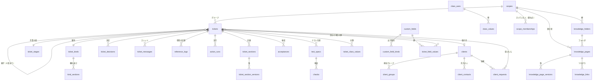

| テーブル | 主な列 | 備考 |
|---|---|---|
| **`tickets`** | `<scoped>`（scope＝グループ）/ `number`（グループの頭文字＋連番・例 EG-128）/ `kind_id` / `stage_id` / `title` / `assignee_member_id`（担当者 ← D-128.25）/ `completed_at` / `completed_by`（完了の時刻と、完了にした人。直せる人なら誰でも完了にできるので押した人を残す ← D-128.138）/ `delegated_to_clone`（分身に任せている。実行者の列は持たない ← D-128.26）/ `client_id` / `parent_ticket_id`（3 段まで ← D-125.51）/ `derived_from_ticket_id` / `start_on` / `due_on` / `priority`（中・高。高は理由が必須 ← D-125.33）/ `estimate_minutes` / `actual_minutes` / `work_type_id` / `work_type_version` / `hold_reason` / `resume_condition` / `priority_reason`（高のときの理由）/ `deleted_by`（消した人。戻せるのは消した本人とマネージャー・管理者 ← D-128.84）/ `created_by` を「作成」で出す（D-128.27） / `draft_import_id`（CSV の取り込みの下書き。確定まで取り込んだ人だけ・D-128.119） / `no_spec_reason`（「AI に任せる」で確認項目が 0 件のとき要る使わない理由。空白だけは断る ← K-434・K-565 が使う） | **★新設（D-125.27・D-127.1）。**`tasks` を置き換える。本文は区画（`ticket_sections`）に分けて持つ |
| **`ticket_sections`** | `<common>` / `ticket_id` / `section_key`（目的・完了の条件・決定ログ・自由欄 など）/ `position` / `body jsonb`（1 枚の文書の一部。見たまま編集の部品 ← D-128.28〜.30）/ `version` | **★新設（D-125.27・D-125.53）。**区画ごとに版を持つ |
| **`ticket_section_versions`** | `<common>` / `ticket_id` / `section_id` / `version` / `body jsonb` / `edited_by` / `edited_at` / `edited_by_clone` | 版と差分（TdVersions）・戻す。追記だけ（直さない・消さない）。読めるのは元のチケットを読める人（D-128.115） |
| **`ticket_kinds`** | `<common>` / `name` / `color` / `position` / `is_builtin` | **★新設（D-125.30）。**タスク・QA・課題・会議。会社が足す（上限 10） |
| **`kind_sections`** | `<common>` / `kind_id` / `section_key` / `label` / `mode`（必須・出す・外す）/ `position` / `default_test_specs jsonb` | **★新設（D-125.52・D-128.48）。**ワークスペースの管理 › 決まり › チケットの形 |
| **`ticket_stages`** | `<common>` / `name` / `position` / `is_fixed`（確認中・承認待ち・実行中は製品が固定） | **★新設（D-125.38）。**会社が直せる段は上限 8 |
| **`class_axes`** | `<common>` / `key` / `name` / `is_builtin` / `position` | **★新設（D-125.67）。**会社が足す軸は上限 5。**凍結（K-563・会社の項目へ移した）** |
| **`class_values`** | `<common>` / `axis_id` / `label` / `color` / `position` | 値の並び・色。**凍結（K-563・会社の項目へ移した）** |
| **`ticket_class_values`** | `<common>` / `ticket_id` / `value_id` | チケットに付けた分類。読めるのは元のチケットを読める人（D-128.115）。**凍結（K-563・会社の項目へ移した）** |
| **`custom_fields`** | `<common>` / `name` / `field_type`（短い文字・長い文章・数・日付・1 つ選ぶ・複数選ぶ・チェック）/ `required` / `description` / `options jsonb`（選ぶ型だけ `[{id, name, position}]`）/ `position` | **★新設（K-563・D-150.36・D-150.37）。**会社が足す項目。分類の軸は「1 つ選ぶ」の項目に移した（項目の id＝軸の id）。数に上限なし |
| **`custom_field_kinds`** | `<common>` / `field_id` / `kind_id` | どの種別で出すか。行が無い項目は全部の種別（K-563） |
| **`ticket_field_values`** | `<common>` / `ticket_id` / `field_id` / `value jsonb`（null 不可） | チケットごとの会社の項目の値（子表。項目の定義はマスタ `custom_fields`）。読めるのは元のチケットを読める人（K-563） |
| **`handover_rules`** | `<common>` / `target`（子・孫のチケット／派生・関連のチケット／所属グループ／会社が足した軸の値 ← D-125.70）/ `axis_id`（target が軸のとき）/ `mode`（毎回聞く・いつも・しない） | **★新設（D-125.70・D-125.71）。**渡すときに一緒に切り替えるもの |
| **`test_specs`** | `<common>` / `ticket_id` / `check_kind`（任意・使わない：確認項目は文とチェックだけ ← D-150.39）/ `title` / `judge_type` / `params jsonb` / `version` / `off_reason`（使わない）/ `checked_at` / `checked_by_member_id` / `checked_by_ai`（チェックの印と付けた人。時刻なしで人・AI は不可・人と AI の両方は不可 ← 守り `test_specs_checked_pair`・`test_specs_checked_one_who`）/ `source`（`manual`・`knowledge`・`ai`・既定 `manual`。守り `test_specs_source_check`）/ `source_ref_id`（出どころのページなど・任意） | **★新設（D-125.17・D-125.79）。確認項目の形は K-434（D-150.39）で直した。付ける・外す・直す・外すは関数 `app.test_spec_update`・`app.test_spec_delete`、機械・AI が付ける道は `app.test_spec_check_by_ai`（K-435）** |
| **`checks`** | `<common>` / `ticket_id`（行の守りのため元のチケットを持つ）/ `test_spec_id` / `spec_version` / `artifact_version_id` / `attempt` / `result`（通過・落ちた・不確か）/ `evidence jsonb`（根拠の引用）/ `runner`（server・bridge・human）/ `checked_by_member_id` | **★新設（D-125.18・D-126.24）。**① はサーバー、② は本人の PC（Bridge）、③ は人 |
| **`ticket_decisions`** | `<common>` / `ticket_id` / `text` / `reason` / `decided_by` / `decided_at` / `source_message_id` / `superseded_by_id` / `promoted_to`（このチケットだけ・取引先のルール） / `decided_note`（決めた人のひとこと） / `cancelled_at` / `cancelled_by` / `cancel_reason`（取り消しは印と理由を残し消さない・⑰） | **★新設（D-125.40・D-125.63）**。決めたことの 2000 字の決まりを外し、空白だけを断る決まりにした（D-130.1・K-390） |
| **`ticket_messages`** | `<common>` / `ticket_id` / `author_member_id` / `kind`（書き込み・変更・仕組み）/ `body` / `mentions uuid[]` / `changes jsonb`（期限 11/01 → 11/02 など）/ `quote_of_id` / `reactions jsonb` / `notify_member_ids uuid[]`（知らせる人に選ばれた人）/ `quote_text`（引用した元の頭の 2 行の写し）/ `edited_at`（本文を直した時刻・☆ では変えない）/ `deleted_by`（消した人） | **★新設（D-125.29・D-125.131・D-128.45）。**チケットのスレッド。足した 4 列は K-383 |
| **`app.ticket_thread_seen`** | `tenant_id` / `ticket_id` / `member_id` / `seen_at`（最後にやり取りを開いた時刻）/ `created_at` / `updated_at`（主キーは tenant_id・ticket_id・member_id） | **★新設（K-383）。**アプリの役が触れない表（app.ticket_drafts と同じ。読み書きは security definer の関数だけ）。「新しい」の印と数に使う |
| **`reference_logs`** | `<common>` / `ticket_id` / `action_run_id` / `ref_type`（ページ・記憶・添付・外の URL）/ `ref_id` / `url` / `title` / `seen_at` | **★新設（D-125.28・D-125.35）。**外は URL・題名・時刻だけ |
| **`knowledge_pages`** | `<scoped>`（scope＝棚：会社＝いちばん上のグループ・グループ・自分＝持ち主の主の所属）/ `is_personal`（自分の棚：持ち主だけ）/ `parent_page_id`（使わない）/ `title` / `summary`（1 行の説明・200 字まで）/ `is_must`（必ず守る・公開済みだけ）/ `copied_from_page_id`（写しの元）/ `folder_id`（フォルダ・空＝棚の直下）/ `position`（並び）/ `owner_member_id` / `state`（下書き・公開・しまった）/ `verify_interval_days` / `verified_at` / `verify_due_on` / `topics text[]`（使わない）/ `current_version` / `form`（使わない）/ `archived_at` / `archived_to_page_id`（使わない） | **★新設（D-125.108・D-128.50〜.52）。K-674 で棚の決めに作り直した（D-152.1・D-152.3）：書ける人＝会社は管理者・グループはそのグループのマネージャー・自分は本人／読める人＝会社は全員・グループはそのグループの人と共有先・自分は本人。権限の束は使わない** |
| **`knowledge_page_versions`** | `<common>` / `page_id` / `version` / `kind`（下書き・直す案・公開）/ `body jsonb` / `note` / `author_member_id` / `proposed_from_ticket_id` / `proposed_by_clone`（チケットの完了で分身が出した直す案）/ `decision`（入れた・直して入れた・入れない）/ `decline_reason` / `decided_by` / `decided_at` / `published_by` / `published_at` | 公開するたびに増える |
| **`knowledge_links`** | `<common>` / `from_page_id` / `to_type`（ページ・チケット・決まり・取引先）/ `to_id` / `anchor` | つながり・被リンク（D-128.52） |
| **`knowledge_folders`** | `<scoped>`（scope＝棚）/ `is_personal`（自分の棚）/ `owner_member_id` / `parent_folder_id`（空＝棚の直下・深さ 6 まで）/ `name`（1〜100 字・同じ棚の同じ親で重ならない）/ `position` | **★新設（K-674・D-152.1）。**ナレッジのフォルダ。読める・書けるは棚の決めと同じ |
| **`clients`** | `<common>` / `name` / `owner_member_id`（取引先の担当）/ `visibility`（全員・担当グループだけ）/ `default_share jsonb`（種別ごとの既定の見せ方）/ `routing`（分身が振り分ける）/ `email_domain`（招待はドメインが合う人だけ） | **★新設（D-125.121・D-128.53・D-128.54）** |
| **`client_groups`** | `<common>` / `client_id` / `scope_id` | 担当グループ（いくつでも ← D-128.54） |
| **`client_contacts`** | `<common>` / `client_id` / `name` / `email` / `role`（依頼できる・見るだけ）/ `member_id`（クライアントの場所に入るとき）/ `cc_role`（請求の宛先・CC・使わない） | 先方の人 |
| **`client_requests`** | `<common>` / `client_id` / `contact_id` / `title` / `body` / `due_on` / `state`（新しい・聞いている・チケットに・断った）/ `ticket_id` / `routed_scope_id` / `questions jsonb`（詳しく聞くこと）/ `decline_reason` | **★新設（D-125.123）。**やり取りは `conversations` に置く |
| **`acceptances`** | `<common>` / `ticket_id` / `artifact_version_id` / `contact_id` / `due_on` / `message` / `result`（OK・直してほしい）/ `comment` / `decided_at` / `reminded_at`（催促した日） | **★新設（D-125.124）。**OK がそのチケットの完了の条件 |
| **`tenant_memberships`** | `<common>` / `auth_user_id` / `member_id` / `role`（管理者・マネージャー・メンバー・閲覧のみ・依頼する側）/ `status` / `joined_at` | **★新設（D-125.150・D-128.46）。**1 人のアカウントが複数のワークスペースに入る。行は本人と、その tenant の管理者だけが読める |
| **`terms_versions`** | `<common>`（tenant_id＝運営）/ `kind`（利用規約・プライバシー・特商法の表示）/ `version` / `url` / `published_at` | **★新設（D-125.162）。**運営の表（tenant_id＝運営） |
| **`terms_consents`** | `<common>`（同意したときのワークスペース）/ `member_id` / `auth_user_id` / `terms_version_id` / `agreed_at` / `ip` | 誰がどの版に同意したか。追記だけ（D-125.162） |
| **`passkeys`** | `auth_user_id` / `credential_id` / `public_key` / `name`（この PC・iPhone など）/ `transports` / `last_used_at` / `revoked_at` | **★新設（D-125.137・D-128.59〜.61）。**Better Auth の passkey の表を使う。置き場はログインの部品の側（kaname_auth）で、業務の表からは読めない（D-128.119） |
| **`operations`** | `<common>`（tenant_id＝運営）/ `key`（browser）/ `name` / `kind`（ブラウザ・MCP・API）/ `current_version` | **★新設（D-126.2・D-126.19）。**第1フェーズは汎用のブラウザ操作 1 つ |
| **`ticket_links`** | `<common>` / `from_ticket_id` / `to_ticket_id` / `kind`（関連・派生元） | **★新設（D-125.50・D-128.80）。**前後（依存）と重複は持たない |
| **`ticket_handovers`** | `<common>` / `ticket_id` / `kind`（渡す・引き取りの申し出・配る・上へ上げる）/ `from_member_id` / `to_member_id` / `to_scope_id` / `reason` / `ask` / `reply_due` / `switch jsonb`（一緒に切り替えるもの）/ `state`（返事待ち・受けた・断った・取り下げた）/ `decline_reason` / `decided_at` | **★新設（D-125.70）。**`task_handovers` を置き換える |
| **`saved_views`** | `<common>` / `member_id` / `name` / `share`（自分だけ・グループの全員）/ `scope_id` / `filters jsonb` / `columns jsonb` / `density` | **★新設（D-128.83）。**検索条件と列の表示設定。同じ名前は 1 人 1 つ（消していない物の中・大文字小文字を区別しない・一意の索引 `saved_views_name_uq`）・1 人 50 件まで（口で守る・K-475） |
| **`ticket_imports`** | `<common>` / `uploaded_by` / `scope_id`（入れるグループ）/ `source`（Backlog の CSV・汎用）/ `mapping jsonb` / `rows int` / `errors jsonb` / `state`（確かめ中・確定・やめた）/ `committed_at` | **★新設（D-128.83・D-128.85）。**取り込んだものは下書き（`tickets.draft_import_id`）で入り、確定するまで取り込んだ人だけが見て直せる（D-128.119） |
| **`learning_candidates`** | `<common>` / `owner_member_id`（その人の分身）/ `trigger`（覚えて・直したところ・差し戻し・話の中で・同じ流れ・完了）/ `proposed_as`（守ること・やり方・覚えていること）/ `text` / `evidence jsonb`（どのチケット・どの話から）/ `check_result jsonb`（分身の点検：ぶつかる決まり・似ているもの・要る OK。check は SQL の言葉と重なるので名前を変えた）/ `decided_by`/ `state`（待っている・覚えた・覚えない・あとで・例外の OK 待ち）/ `decided_at` / `result_type` / `result_id` | **★新設（D-128.41・D-128.43・D-128.90）。**「覚えたいこと」。決めるまで使わない。例外の OK が要るものは承認待ちへ（D-128.89） |
| **`bridge_pairing_codes`** | `<common>` / `member_id` / `code_hash`（コードそのものは持たない）/ `expires_at`（10 分）/ `used_at` / `used_session_id` | **★新設（D-128.93）。**PC をつなぐ接続コード。1 回だけ。使うと `sessions(kind=bridge)` ができ、本人のセッションに結ばれる |
| **`notification_settings`** | `<common>` / `member_id` / `email_digest`（読んでいないものを 30 分ごとにまとめて送る）/ `quiet_hours jsonb`（平日 20:00〜8:00・土日 など）/ `paused_until` / `urgent_override jsonb`（止めていても知らせる出来事） | **★新設（D-128.92）。**ワークスペースごと（tenant_id）。出来事ごとの届け先は `notification_preferences`（受け箱・メール。push は後のフェーズ） |
| **`ops_plan_proposals`** | `<common>`（tenant_id＝運営）/ `plan_id` / `from_version` / `to_version` / `changes jsonb` / `existing_policy`（N 日後から・ずっと今の値段）/ `notice_days` / `new_from` / `reason` / `proposed_by` / `decided_by` / `state`（下書き・決める人を待っている・決めた・差し戻した）/ `decided_at` / `return_reason` | **★新設（D-128.72）。**作った人と決めた人は同じにできない（決められる人が 1 人のときだけ例外・本人確認） |
| **`scope_memberships`** | `<common>` / `member_id` / `scope_id` / `is_primary`（主の所属か兼ねるか）/ `role`（そのグループでの役割：マネージャー・メンバー・閲覧のみ）/ `since` / `changed_by` | **★新設（D-125.115・D-128.95〜.97）。**1 人が複数のグループに入る（兼ねる）。グループごとに役割を分ける。ワークスペースの役割は `tenant_memberships.role` |
| **`role_bundle_defaults`** | `role`（管理者・マネージャー・メンバー・閲覧のみ）/ `target_kind_id` / `ability_id` / `scope_kind`（会社全体・その人のグループ） | **★新設（D-125.117・D-128.97）。マスタ（製品の既定）。**役割の束の中身。ワークスペースとグループの役割から権限の行（`permissions.bundle_role`）を作る。会社が足す役割は後のフェーズ |

`approvals` に足す列（第1フェーズ・D-128.86・D-128.87・D-128.89）：`ticket_id` / `kind`（AI の成果物・上位の承認・決まりの例外・やり方を広げる）/ `subject_type` / `subject_id`（決まりの例外は守ることの案、やり方を広げるはやり方の版を指す）/ `level` / `parent_approval_id` / `escalated_by_policy_id`（どの決まりで上位へ回ったか）/ `decision`（承認・自分で直す・差し戻し・止める）/ `decided_at` / `return_targets jsonb` / `return_reason` / `next_actor`（分身・自分）/ `memory_candidate` / `human_checks jsonb` / `irreversible`（骨格では全部 true・D-128.177）/ `step_up_at`（直前の本人確認。AI の成果物の承認では取り直さないので使わない・D-128.177 で approvals_step_up_ck を外した）/ `withdrawn_at`（取り下げ）/ `bulk_batch_id`。まとめて承認は ① がすべて確実・人が見る項目なし・取り消せる操作だけ（サーバーがもう一度確かめる）。

分身の部屋で足す列（D-128.40〜.44・D-128.90）：
- `policies`（守ること）：`text`（一文）/ `applies_to`（自分の仕事すべて・取引先・種別）/ `client_id` / `kind_id` / `source_ref`（元のチケット・話）/ `version` / `paused_at`（一時的に効かせない）/ `use_count` / `last_used_at` / `exception_of_policy_id`（どの決まりの例外か）/ `exception_approval_id`。範囲は `scope_id`（自分・取引先・層・ワークスペース）
- `memories`（覚えていること）：`kind_id`（好み・事実・実例）/ `auto`（自動で覚えた）/ `source_type_id`・`source_ref_id`（どの話・どのチケットから）/ `use_count` / `last_used_at` / `visibility`（自分だけ・勧めた）
- `skills`（やり方＝業務の型）：`<scoped>` にする（運営・ワークスペース・層・自分）。`skill_versions` に `fields jsonb`（いつ使う・確かめること・書式と手本・注意と禁止・使う操作）/ `state`（下書き・使っている）/ `checked jsonb`（機械の検査の結果）を足す。試すは `skill_test_runs`（外に出ない）。広げる申請は承認待ち（D-128.89）
- `clones`：`auto_memory`（自動で覚える。既定 入・D-128.90）。許可のモードは `members.agent_permission_mode` のまま

自分の設定で足す列（D-128.55・D-128.57・D-128.58）：
- `credentials`（預けたログイン情報）：`name`（名前）/ `description`（説明）/ `layer`（workspace ／ personal。個人の物は持ち主だけが読む・書く・K-351）/ `scope_id`（自分・層・ワークスペース）/ `destinations text[]`（使える場所：ドメイン・API の宛先。ここ以外では実行器が入れない・送らない）/ `read_only`（見るだけ）/ `client_id` / `purpose` / `expires_at` / `use_count` / `last_used_at`。取り出せるのは、持ち主（自分のものは本人の分身の実行・層やワークスペースのものはその範囲の人の実行）の PC の実行器だけで、宛先が合うときだけ（D-128.57）
- `members`：`call_name`（呼ばれ方・20 文字）/ `avatar_ref` / `language` / `theme` / `week_start` / `timezone` / `setup_dismissed_at`（はじめにやることを閉じた）。名前は 100 文字まで（D-128.58）


ワークスペースの管理で足す列（D-128.95〜.98）：
- `tenants`：`logo_ref` / `client_visibility_default`（取引先を見られる人の既定）/ `request_routing`（依頼の届け先：分身が振り分ける）/ `deletion_requested_at`（消す手続き。14 日は取り消せる・`account_events(kind=company_close)` と対） / `session_idle_hours`（操作が無いと切る時間・既定 12・1〜12）/ `session_max_days`（最長・既定 7・1〜7。管理者は短くできるが長くはできない ← D-125.140・K-20）
- `permissions`：「誰ができるか」の 3 つ（プランと支払い・書き出す・ワークスペースを消す）は `abilities` に `billing` / `export` / `delete_workspace` を足して同じ表で持つ。個別に足す・外すも同じ表（`revoked_at`）
- `members`：`suspended_at` / `suspended_by`（一時的に止める。入れなくなり分身も止まる。担当はそのまま）
- `policies`：`kind`（守ること・上に回す）/ `escalate_when jsonb`（何のとき・条件）/ `escalate_to`（そのグループのマネージャー・決まった人・取引先の担当）。上に回す決まりも同じ表（D-128.87）
- `kind_sections`：`position` / `mode`（必須・出す・外す）/ `content_type`（文章・箇条書き・表・チェックリスト・日付）/ `hint` / `client_visible` / `used_for_acceptance`。種別ごとに 20 まで

取引先とクライアントの場所で足す列（D-128.100〜.104）：
- `clients`：`email_domain`（先方の人を足すときに取引先を当てる・分身が取引先の案を出す。Kaname はメールを受け取らない・D-128.102）
- `tickets`：`client_share jsonb`（このチケットで先方に見せるもの。取引先の種別ごとの既定 `clients.default_share` から始まり、チケットごとに変えられる。テスト仕様・決定ログ・分身の記録は入れられない）。先方に出るのは、取引先が付いたチケットのうち「題名と進み」を見せるもの（依頼から作ったかは問わない・D-128.100）
- `client_requests`：`questions jsonb`（担当の分身が聞いたこと。担当の PC が閉じていたら、あとでやり取りの中で聞く・D-128.101）
- `acceptances`：`reminded_at`（催促した日。期限の前日に自動でも 1 回）
- 先方の人への知らせは `notifications` の `channel_id = email` で出来事ごとに送る（確認してほしいもの・依頼への返事・催促）。メールにはリンクだけ載せ、本文・成果物は載せない（D-128.103）

ナレッジで足す列（D-128.105・D-128.106）：
- `knowledge_page_versions`：`kind`（下書き・案・公開）/ `author_member_id` / `proposed_from_ticket_id` / `proposed_by_clone`（チケットの完了で分身が出した直す案）/ `decision`（入れた・直して入れた・入れない）/ `decline_reason` / `decided_by` / `decided_at`。下書きと直す案も同じ表で持ち、公開したときだけ `version` が増える
- `knowledge_pages`：`archived_at` / `archived_to_page_id`（しまって新しいページへつなぐ）
- ページのやり取りは `messages`（`owner_type = knowledge_page`）に置く

運営の残りと困ったとき・お知らせで足す列（D-128.108〜.110）：
- `support_access_grants`：「中を見る」の許可として使う。`reason`（必須）/ `inquiry_id`（理由に選んだ問い合わせ）/ `expires_at`（1 時間）/ `closed_at`。顧客が許可する形（D-074.5）はやめ、規約での先の許可にした（D-125.128）
- `audit_events`：運営がしたこと（中を見た・止めた・再開した・入金を記録した・代わりにプランを変えた・本人確認のメールを送り直した）は `ops_audit_events` に加えて、相手のワークスペースの `audit_events` にも `actor_role = ops` で書く（D-128.108）
- `ops_members`：`caps text[]`（問い合わせ・中を見る・お金・止める・お知らせ・配るもの・値段の案・値段を決める・運営の人）。`ops_role_id` は見出し（運営の管理者・サポート・お金）だけに使う
- `notices`：`state`（下書き・予定・出した）/ `affects jsonb`（画面・分身の実行・PC とのつながり）/ `placements text[]`（一覧・上の帯・メンテ中の画面）/ `maintenance_from` / `maintenance_to` / `emailed_admins_at`（メンテだけ管理者にメール・D-128.109）
- `status_incidents`：`notice_id` / `state`（調べている・原因が分かった・様子を見ている・直った）/ `body`。お知らせ 1 件に状態を足していく
- 関数 `app.public_service_status()`（security definer・K-307）：ログインしていない人にも出してよい分だけを返す（直っていない障害のうち、全部向けに公開したお知らせに結んだもの＝state・お知らせの題・started_at／いま中のメンテナンス＝題・from・to）。`notices` と `status_incidents` の行の守り（運営だけ）は変えない。表と列は足さない
- 関数 `app.login_gate(p_auth_user_id text) returns text`（security definer・kaname_app だけが呼べる・K-303）：ログインの部品がセッションを作る直前（packages/auth の session.create.before）だけが呼ぶ止めの 1 か所。member の行と同じ組の所属の行（tenant_memberships）を見て `ok`／`member_suspended`（`members.suspended_at` か所属の `status = suspended`）／`workspace_suspended`（`subscriptions.suspended_at`）／`member_left` を返し、断ったときは使える会社ごとの `security_events` に `login_blocked`（detail は理由だけ）を書く。表と列は足さない
- 関数 `app.request_admin_recovery(p_auth_user_id text, p_ip_region text) returns jsonb`・`app.admin_recovery_send_failed(p_auth_user_id text, p_failed uuid[]) returns int`（security definer・kaname_app だけが呼べる・K-305）：端末をなくした人が管理者に戻してもらうよう頼む口だけが呼ぶ。本人が今いる会社ごとに `security_events`（`admin_recovery_requested`・detail はその会社で選んだ宛先の数 `admins` だけ・送れなかったら `admin_recovery_send_failed`）、本人でない管理者（所属の `role = admin` かつ `active`、か `members.role_id = owner`。抜けた・止められた人は除く）ごとに受け箱 `notifications`（`security.admin_recovery_requested`・payload は `requester_member_id` だけ・`failed_at`／`retry_count`／`sent_at`）。1 時間に 1 回（送れなかった行と、送り中のまま 2 分を過ぎた行を、いまの管理者の分だけ送り直す。宛先が 0 の回の押し直しは no_admin）。宛先を選ぶのは中だけの関数 `app.admin_recovery_admins` の 1 か所。表と列は足さない
- `inquiries`：`context jsonb`（いま見ている画面の情報：画面の場所・時刻・ブラウザ・PC のつながり）/ `later_until`。運営の社内メモは `messages` の `visibility = ops_only`

前の表の扱い：`tasks` `task_handovers` `daily_plans` は後のフェーズ（チケットに置き換え）。`skills` 系は「業務の型」として使い続ける（`skills.kind_id` に work_type を足す・D-126.26）。`learned_procedures` は「記録した動かし方」として使い続け、入力した値を空欄に置き換えた形だけを持つ（D-126.25）。`support_access_grants` は「運営の閲覧」の記録として使い、許可の範囲と期限は契約で先に持つ（D-125.128・D-128.68）。

---

## オブジェクト ↔ テーブル（機械照合：`scripts/ci/er_gate.py`）

> `05_flow/flow.json` の `objects[]` 全部について、実体となるテーブルを書く。テーブルが無いものは `—` と理由。
> 検査：オブジェクトに行が無い／行のテーブルがこの文書に定義されていない → FAIL（決めたのに DB に無い、を機械で出す）。

| オブジェクト | テーブル | 備考 |
|---|---|---|
| はじめの設定の進み具合 | `members` | 列 `setup_step`（0〜6）。独立した表にしない（1 人 1 値・戻らない）。段の名前は `setup_steps`（マスタ）。上げるのは `app.setup_step_done`（D-089） |
| 会社モデル | `tenants` `goals` `ledger_definitions` `duties` `scopes` `policies` `memories` | 1 つの定義＝これらの版の集合（D-010）。`company_model_versions` は持たず各表の `version` で表す |
| 自分のAI | `clones` `members` `learning_candidates` | 1 人 1 体（D-060）。覚えたいことは `learning_candidates`（D-128.41） |
| AI社員 | `ai_employees` `members` | 出どころは `distributions`（D-037） |
| 担当業務 | `duties` `duty_versions` | |
| 記録した動かし方 | `learned_procedures` `procedure_steps` | 入力した値は空欄に置き換えて持つ。消せたものだけ全社で共有（D-126.25） |
| 実行 | `action_runs` | `ticket_id` と使った業務の型の版を持つ。テストモードは `action_runs.mode_id`（D-028・D-076.7・D-126.14） |
| 目標 | `goals` `goal_versions` | |
| 単位 | `units` | 顧客が作れる |
| 配分 | `goal_allocations` `goal_contributions` | 配り方（合意／指示）は `goal_allocations.agreement_status_id`（D-076.12） |
| 仮説 | `hypotheses` | |
| 施策 | `measures` | |
| 検証 | `validations` | |
| 台帳 | `ledger_definitions` `ledger_views` | |
| 台帳の定義 | `ledger_definitions` `ledger_fields` `ledger_stages` | |
| レコード | `ledger_records` | |
| 段階 | `ledger_stages` | |
| チケット | `tickets` `ticket_class_values` `ticket_links` `ticket_handovers` `saved_views` `ticket_imports` | 本文は `ticket_sections`（D-125.27・D-127.1）。つながり・渡す・保存した検索条件・CSV の取り込み（D-128.80・D-128.83） |
| 一日の計画 | `daily_plans` | |
| 承認 | `approvals` | 4 つのボタン・差し戻しの理由・本人確認（D-125.103）。第1フェーズで足す列は §16 の注記 |
| 差し戻し | `approvals` `messages` | 差し戻し＝`approvals.status_id = returned` ＋ 理由の `messages` |
| 申し送り | `messages` `daily_plans` | 自分のAIの朝の申し送り＝`messages.kind = status`、夕方の持ち越しは `daily_plans.carry_over` |
| 記憶 | `memories` | 4 層は `scope_id`（D-072.22）。決まり＝rule は上の層ほど強い（D-105.8） |
| 記憶のまとめ | `memory_digests` | 毎朝人が押す（D-105.2） |
| 記憶の上げる候補 | `memory_proposals` | 上げ先・確認者・食い違いの束（D-105.6・D-105.9） |
| 許可の決まり | `permission_rules` | 「いつも」にしたもの（D-104.14） |
| 自分のAIの使用量 | `agent_usage_snapshots` | サブスクの枠（D-104.16） |
| 検索の索引 | `search_embeddings` `embedding_models` | 台帳・記憶・証跡を意味で探すためのベクトルと、それを作るモデル（D-098） |
| ルール | `policies` | 範囲の札＝`scope_id`（D-072.26） |
| サービス台帳 | `service_registry` `service_registry_versions` `service_requests` | |
| 設定 | `credentials` | 画面では「預けたログイン情報」。vault の参照 ID のみ（D-128.57） |
| Bridge | `sessions` | `kind = bridge` の行。接続状態と失効 |
| サーバー実行経路 | `action_runs` | `route_id`（bridge / server）。段階 2 で本格化（D-045・D-055） |
| 証跡 | `audit_events` `ops_audit_events` `security_events` | 会社側・運営側・セキュリティの出来事 |
| メンバー | `members` `permissions` `layers` `scope_memberships` | 権限＝誰に×何に×どの層で×できること |
| 招待 | `invitations` | |
| 保留の申し込み | `pending_signup` | 確認するまで会社も利用者も作らない（D-088.2） |
| 効く範囲 | `scopes` `layers` | 層は会社ごと |
| ひな形 | `distributions` | 運営が配る層とマスタのひな形（kind=template）。会社は取り込んだら独立して使う（D-125.72） |
| テストモード実行 | `action_runs` | `mode_id = test`（外に出ない・台帳は仮想） |
| 添付 | `attachments` | |
| 通知 | `notifications` `notification_preferences` `notification_settings` `notice_deliveries` | 第1フェーズは受け箱とメールのまとめ（D-128.92） |
| プラン | `plans` `plan_versions` `subscriptions` `usage_meters` `plan_change_requests` `ops_plan_proposals` | 値段を変える案と決めた記録は `ops_plan_proposals`（D-128.72） |
| 問い合わせ | `inquiries` `conversations` | |
| お知らせ | `notices` `notice_deliveries` `status_incidents` | |
| 請求 | `invoices` `payments` | 段階 1 は請求書払い |
| 会話 | `conversations` `messages` | |
| Bridge の配布物 | — | 表を持たない。版・OS と CPU ごとのファイル・指紋（sha256）・大きさは置き場の目録ファイル `kaname-bridge.json` が正本（D-109.8）。会社の行を持たないので行の制御の対象も無い |
| AIに頼んだこと | `bridge_jobs` `bridge_job_states` | 待っている／動いている／終わった／止まった／やめた。止まったものは人が選ぶまで残す（D-090） |
| AIの途中経過と確認 | `bridge_job_events` | 何をしているか・会話の id・「これを実行していいか」と本人の答え（D-093）。答えは `audit_events` にも。道具の呼び出しと使った量も（D-100） |
| 持ち出し | `export_jobs` | |
| 出来事 | `account_events` `account_event_items` `retention_holds` `erasure_certificates` | 7 つの出来事と依存の処理・法令保管・消去の証明 |
| 運営の閲覧 | `support_access_grants` `ops_audit_events` | 理由・1 時間・見るだけ（D-128.68） |
| 公開申請 | `review_requests` |  |
| 取り込み | `imports` |  |
| 正規連携 | `integrations` | 資格情報は `credentials` 経由 |
| エラー | `error_events` | 正本は errors.json |
| 配布物 | `distributions` `distribution_versions` `tenant_distributions` | マスタ・版・会社ごとの状態 |
| 運営メンバー | `ops_members` |  |
| 定期実行 | `triggers` | 取りこぼしの扱いは `on_missed_id` |
| 業務の型 | `skills` `skill_versions` `skill_test_runs` `skill_attachments` | kind に work_type を足す。顧客には欄と説明だけ（D-126.21） |
| 変更履歴 | `goal_versions` `duty_versions` `plan_versions` `distribution_versions` `service_registry_versions` `audit_events` | 版の表の総称 |
| 能力表 | — | 段階 2（D-055）。経路ごとの能力は `distributions(kind=capability)` か固定表で持つ。段階 1 は Bridge だけなので表が無い |
| 成果物 | `artifacts` |  |
| 成果物の版 | `artifact_versions` | 直す・戻すごとに 1 行（D-106.3・D-106.4） |
| セキュリティ開示資料 | — | 段階 2〜4 の運営の文書。`distributions(kind=document)` で持てる。段階 1 では作らない |
| 端末 | `sessions` `bridge_pairing_codes` | web / bridge / push の宛先。PC は接続コードでつなぐ（D-128.93） |
| 支払い方法 | `payment_methods` | 段階 2（D-082）。カードは Stripe の参照だけ |
| 決済の出来事 | `billing_events` | 段階 2（D-082.3）。webhook の写し |
| LLM の経路 | `llm_routes` | 段階 2（D-083）。運営の許可を含む |
| 能力表 | `llm_capabilities` | 段階 2（D-083.2）。3 社で揃える |
| 通知の端末 | `push_devices` | 段階 2（D-084.3） |
| 開示資料 | `disclosure_versions` | 段階 2（D-085）。運営の版 |
| サブプロセッサ | `subprocessors` | 段階 2（D-085.2）。事前通知 |
| 操作 | `operations` | 第1フェーズは汎用のブラウザ操作だけ（D-126.19） |
| 区画 | `ticket_sections` `ticket_section_versions` `kind_sections` | |
| テスト仕様 | `test_specs` | |
| 検査 | `checks` | |
| 決定 | `ticket_decisions` | |
| 参照の記録 | `reference_logs` | |
| スレッド | `ticket_messages` | |
| 分類の軸と値 | `class_axes` `class_values` | |
| 種別 | `ticket_kinds` `kind_sections` | |
| 作業の段 | `ticket_stages` | |
| 切り替えの決まり | `handover_rules` | |
| ナレッジのページ | `knowledge_pages` `knowledge_page_versions` `knowledge_links` `knowledge_folders` | フォルダはページの置き場（棚の中の入れ子・K-674） |
| 取引先 | `clients` `client_groups` `client_contacts` | |
| 依頼 | `client_requests` `conversations` | |
| 検収 | `acceptances` | |
| テナントへの所属 | `tenant_memberships` | |
| 規約と同意 | `terms_versions` `terms_consents` | |
| パスキー | `passkeys` | |
| 層 | `layers` `scopes` `scope_memberships` | 兼ねる（D-125.115） |
| かけたもの | `measures` `tasks` `ledger_records` | `measures.budget_amount`・`tasks.actual_minutes`・`ledger_records.goal_id / measure_id`（D-063） |

---

## 根拠となる決定（トレーサビリティ）

> 正本は `01_hearing/決定ログ_進行中.md`。この表が無いと「決めたのにテーブルに反映されていない」を機械で検出できない。
> 規約: `.claude/rules/common/decision-traceability.md` ／ 検査: `python3 scripts/ci/trace_gate.py`

| 決定 | 何を決めたか | 効いているテーブル |
|---|---|---|
| D-125 | 第1フェーズをチケット中心に決め直した（区画・テスト仕様・検査・決定・スレッド・参照の記録・分類・種別・作業の段・切り替えの決まり・ナレッジのページ・取引先・依頼・検収・所属・規約と同意・パスキー） | §16 の表・AI社員を役割に（D-125.152） `members` `distributions` `invitations` |
| D-126 | 業務の型と AI の動き方を決め直した（AI社員・役割はなくし、AI はチケットの責任者の権限で動く。配るのは業務の型。装着はやめ、型はチケットを作るときに選ぶ） | `members` `distributions` `skill_attachments` |
| D-128 | 担当者（実行者の列なし）・ワークスペースの管理の決まりとチケットの形・ナレッジのつながり・取引先と部署・プランの値段を変える案 | `tickets.assignee_member_id` `tickets.delegated_to_clone` `kind_sections` `knowledge_links` `client_groups` `ops_plan_proposals` |
| D-072 | タスクは親子で開ける（親の行に ▸ と終わった数／全部・親の中身に子の一覧・足す／自分のAIに分けてもらう・ガントで親の下に子） | `tasks.parent_task_id`（自己参照。子の goal_id は親と同じにするかは実装時に決める：既定は親から継ぐ）。表の追加は画面タスク T-U-16 の migration で行う |
| D-116 | 6 本番へは、切り替える前の確認に赤が無ければ切り替えられる（黄は承知のうえで）。押したら通し、翌朝から動く | `tenants.live_at` `tenants.live_by` `ai_employees.paused_at`（止めたまま本番へ） `action_runs.ai_employee_id/duty_id/mode_id`。判定は `app.onboard_golive`、切り替えは `app.onboard_golive_switch`（段 6 を通した記録・証跡 golive.switched）、止めるは `app.golive_pause`（0070） |
| D-112 | 自分のAI の会話は本人の PC の Claude Code の記録が正本（文を記録と同じ id で写す） | `messages.transcript_uuid`（会話の中で一意）。書くのは `app.bridge_entries`、取り戻す先は `app.bridge_mirror_targets`、結末は `app.bridge_finish_job`（写した文があれば答えを重ねない） |
| D-120 | AI が使うブラウザを PC ごとに Kaname で選ぶ・もう一度確かめる | `sessions.browser` `bridge_jobs.browser`。`app.agent_set_browser` / `app.bridge_set_browser` / `app.bridge_browser` / `app.bridge_job_browser` / `app.agent_browser_check` / `app.bridge_state`（browser を足す）（0057） |
| D-110 | 自分のAI が Kaname の道具でたたき台に置く（鍵はその仕事の間だけ・証跡） | `bridge_jobs.tool_token_hash` `goals` `goal_versions` `ledger_definitions` `duties` `ai_employees` `members` `units` `memories` `audit_events`。書くのは `app.agent_goal_set` / `app.agent_ledger_set` / `app.agent_duty_set` / `app.agent_draft_remove` / `app.agent_remember_tool`（security definer・会社をまたがない） |
| D-104 | 会話は人が分けて一覧から戻る・書きながら出る返事・止める／直す／順番待ち・資料を付ける・許可は Claude と同じ・使用量 | `conversations` `bridge_jobs` `bridge_job_events` `messages` `permission_rules` `agent_usage_snapshots` `attachments` `artifacts` |
| D-105 | 記憶は毎朝人が押してまとめる・上の層へ上げる候補・決まりは上ほど強い | `memory_digests` `memory_proposals` `memories` |
| D-106 | 成果物は会話の横で開いて直し、版を残して戻せる・返事から書き出す | `artifacts`（`title` `owner_member_id` `current_version` `source_conversation_id`）・`artifact_versions`。読む・直す・戻すは `app.artifact_*` を通す |
| D-107 | 規約で自動操作が禁止のサービスと銀行は、全部許可でも PC の上で止める | `service_registry`（forbidden・bank の `domain`）→ `app.bridge_blocked_domains`。止めた記録は `bridge_job_events`（kind＝blocked）と `audit_events` |
| D-108 | 目標の名前は版に持つ・預けたログイン情報の一覧・たたき台は 1 回で読む | `goal_versions.name`・`credentials.service_name` `service_domain`・`app.onboard_draft`・`app.my_credentials` |
| D-004 | LLMは顧客のサブスク内(Bridge)が既定。APIは顧客負担。運営マネージドは既定OFFの管理者トグル | `credentials` |
| D-010 | 製品の背骨。会社モデル(目標・台帳定義・担当業務・組織・ポリシー・記憶)を1つの定義に。画面もAI社員も自動実行もこの定義だけを読む。AIが | `all` |
| D-013 | 実行層は接続の器を1回作れば設定で増える形にする。連携を1本ずつ書かない | `service_registry` |
| D-017 | vaultにID/PW＋TOTPシークレットを暗号化保管し実行器が直接入力。AIには一切渡さない(参照IDのみ) | `credentials` |
| D-026 | スコープ4層(運営/会社/部署/個人)を担当業務・ルール・テンプレ・覚えた操作・記憶すべてに同じ形で使う | `scopes` |
| D-032 | 目標の階層と配分。スコープ層と目標階層は別概念。未配分の可視化。配る権限。合意/指示の2通り。AI社員にも配れる。未達は下から上へ返る。段の | `goals` |
| D-034 | 目標は双方向。降ろす(逆算)と積み上げる(実績)が同じ画面に出る | `goals` |
| D-035 | 目標とタスクの間に仮説と施策を置く。目標→現状分析→仮説→施策→タスク→検証→次の仮説。効かなかった仮説も残す | `hypotheses` |
| D-037 | AI社員の出どころは運営配布/会社作成/個人作成の3経路。託されたAI社員は使えるが定義は編集できない。個人ルールだけは足せる。★本人のクロ | `members` |
| D-038 | 台帳は『計算しないが、結果は持つ』。CRM/会計の計算は担わないが結果は台帳に持つ | `ledger_definitions` |
| D-041 | サービス台帳で外部サービスごとの自動操作可否を持つ(api/allowed/unspecified/forbidden/bank)。規約で自 | `service_registry` |
| D-058 | 目標はログイン中の個人まで落ちる。層ごとの可視性（上をどこまで見せる／下をどこまで見る／横）。横の引き取り | `goals`（`visibility jsonb`）/ `goal_allocations` / `tasks.assignee_id` の移譲と `task_handovers`（新設） |
| D-060 | 呼び方：用語「自分のAI」・画面は本人の名前＋AI（旧称 自分のAI／COO） | `members.ai_display_name`（既定＝姓＋AI・付け替え可）/ `memories`・`policies` のスコープ「個人（自分のAI）」 |
| D-061 | 目標・配分・タスク・担当は依存して動く。足す／渡す／変える／無くす に反映規則 | `tasks.goal_id null可`・`tasks.goal_changed_at`・`task_handovers`（新設）・`goals.ended_at`・`goal_versions` |
| D-068 | タスクの作法と見え方：一日の型（朝の確定・夕方の持ち越し）、状態 4 つ、次の一手・見込み／実時間・詰まりの理由、見え方は URL | `daily_plans`（新設）・`tasks.next_action / estimate_minutes / planned_for / blocked_reason_id / blocked_since`・`task_handovers`（言葉の変更）。見え方はテーブルを持たない（URL の状態） |
| D-063 | 目標・施策に「かけたもの」（予算・実コスト・時間・活動）を持ち「出たもの」と並べる | `measures.budget_amount / budget_unit_id`・`ledger_records.goal_id / measure_id`（任意）・`tasks.actual_minutes`・`task_activities`（訪問・提案等の活動種別＝マスタ） |
| D-062 | 会話は 1 本・見え方 2 つ・領域×対象×流れの 3 層・AI 社員の動きは 1 本の木 | `conversations.area / subject_type / subject_id / parent_conversation_id`・`action_runs`（動きの木） |
| D-066 | 会話の部品は 1 組（選択肢・承認カード・受領・自信と引用・分岐・取り消し） | `messages.kind / options / confidence / citations / parent_message_id / undo_action_run_id` |
| D-069 | エラーは一覧（正本 errors.json）から導き、1 件＝出る／出ない／文言と一手 | `error_events`（D-069.3・D-069.4） |
| D-073 | 権限の型（自分のものは自由・それ以外は 誰に×何に×どの層で×できること）・層は会社ごと・自分のAIは全員が持つ・運営の画面 | `permissions` / `abilities` / `target_kinds`（D-073.1〜D-073.3）・`layers`（D-073.4）・`clones`（D-073.5）・`ops_members`（D-073.7） |
| D-074 | 抜ける・退会の依存を全オブジェクトで決める・順番・運営 6 画面・サポートアクセス | `account_events` / `account_event_items`（D-074.1〜D-074.3）・`retention_holds` / `erasure_certificates`（D-074.3）・`review_requests` / `ops_audit_events`（D-074.4）・`support_access_grants`（D-074.5） |
| D-075 | 往復するもの 6 つ（問い合わせ・お知らせと稼働状況・通知の届け先・プランと利用量・請求と入金・セキュリティの出来事） | `inquiries`（D-075.1）・`notices` / `notice_deliveries` / `status_incidents`（D-075.2）・`notification_preferences`（D-075.3）・`subscriptions` / `usage_meters`（D-075.4・D-075.5）・`invoices` / `payments`（D-075.4）・`security_events`（D-075.6） |
| D-076 | 自分のアカウント・会社の設定・取り込み・外部サービスの連携・サービス台帳の版・プランの定義・テストモードの再入・使える手段・稼働の経路・目標スキル・繰り越し・配り方・出来事 5 つ | `sessions`（D-076.1）・`subscriptions.billing_contact` / `tenants`（D-076.2）・`imports`（D-076.3）・`integrations`（D-076.4）・`service_registry_versions` / `service_requests`（D-076.5）・`plans` / `plan_versions`（D-076.6）・`action_runs.mode_id`（D-076.7）・`action_runs.route_id`（D-076.9）・`distributions(kind=goal_skill)`（D-076.10）・`goal_allocations.agreement_status_id`（D-076.12）・`account_events`（D-076.13） |
| D-077 | 運営の対応は会社の 1 社の中で。横断は入口。全体のもの（お知らせ・配るもの・プランの定義・サービス台帳・運営メンバー）はマスタ | `tenant_distributions`（D-077.6）・`ops_audit_events`（D-077.7）・`notices.target_tenant_id`（D-077.8）・`payments.recorded_by_ops_member_id` / `inquiries.assignee_ops_member_id` / `review_requests`（D-077.1・D-077.3）・`plans`（D-077.5） |
| D-002.2 | 3 層のプラン | （決めたことの文） |
| D-003.2 | 資産は履歴 | （決めたことの文） |
| D-004.1 | LLM 実行経路 | （決めたことの文） |
| D-004.10 | セキュリティ | （決めたことの文） |
| D-006.1 | スコープの判断基準 | （決めたことの文） |
| D-006.5 | 外部 SaaS からは連携で数値だけ取る | （決めたことの文） |
| D-010.1 | 会社モデルの定義 | （決めたことの文） |
| D-010.4 | 数値の型は 2 つ | （決めたことの文） |
| D-010.5 | 定義で描く・コード変更不要 | （決めたことの文） |
| D-012.2 | 全変更に履歴 | （決めたことの文） |
| D-012.3 | 定義を中身と同じ場所に置く | （決めたことの文） |
| D-013.1 | 接続の器を1回作る | （決めたことの文） |
| D-013.3 | 資格情報の注入 | （決めたことの文） |
| D-013.6 | 習得状態の表示 | （決めたことの文） |
| D-017.1 | vault に暗号化保管し実行器が直接入力 | （決めたことの文） |
| D-017.2 | TOTP（認証アプリ）は可能 | （決めたことの文） |
| D-017.3 | メール OTP は可能 | （決めたことの文） |
| D-018.1 | 座標でなく意味で記録 | （決めたことの文） |
| D-018.2 | 手順と中身を分ける | （決めたことの文） |
| D-022.1 | 担当業務にぶら下げる | （決めたことの文） |
| D-022.2 | 日本語の手順として見せ、技術的中身は隠す | （決めたことの文） |
| D-022.3 | 実行の統計と直す・覚え直す | （決めたことの文） |
| D-022.4 | スコープ4層は記憶と同じ構造 | （決めたことの文） |
| D-022.5 | テナント間で絶対に漏らさない | （決めたことの文） |
| D-022.6 | 共有は匿名化＋人の確認＋審査 | （決めたことの文） |
| D-022.7 | 認証情報は手順に含めない | （決めたことの文） |
| D-024.4 | 担当業務は旧スキルと中身が違う | （決めたことの文） |
| D-025.2 | 隠すもの | （決めたことの文） |
| D-025.5 | ファイルで一括アップロード | （決めたことの文） |
| D-025.6 | エクスポートはあえて許す | （決めたことの文） |
| D-026.1 | 4層の定義 | （決めたことの文） |
| D-026.2 | 運営層の扱い | （決めたことの文） |
| D-026.3 | 会社層の編集権限 | （決めたことの文） |
| D-026.4 | 部署・チーム層は任意 | （決めたことの文） |
| D-026.5 | 個人層は本人が自由 | （決めたことの文） |
| D-026.7 | 運営の安全ルールは上書き不可 | （決めたことの文） |
| D-026.8 | 同じ4層をすべての部品に使う | （決めたことの文） |
| D-027.2 | 運営が公式を用意する | （決めたことの文） |
| D-027.4 | 他社への公開は明示＋匿名化＋審査 | （決めたことの文） |
| D-028.2 | テストモードは外に一切出さない | （決めたことの文） |
| D-028.5 | 担当業務ごとにいつでもテストに戻せる | （決めたことの文） |
| D-029.1 | 形式は指定しない | （決めたことの文） |
| D-029.2 | 受け取れるものと用途 | （決めたことの文） |
| D-030.6 | 目標の分解 | （決めたことの文） |
| D-032.1 | 軸は2本 | （決めたことの文） |
| D-032.2 | 配られた目標と自主目標 | （決めたことの文） |
| D-032.3 | 未配分の可視化 | （決めたことの文） |
| D-032.4 | 配る権限 | （決めたことの文） |
| D-032.5 | 配り方は2通り | （決めたことの文） |
| D-032.8 | 段の数は固定しない | （決めたことの文） |
| D-032.9 | 親子で単位が変わる（3型） | （決めたことの文） |
| D-032.10 | 単位は運営が列挙しない | （決めたことの文） |
| D-035.1 | 目標とタスクの間に仮説と施策 | （決めたことの文） |
| D-035.3 | 器と質を分ける | （決めたことの文） |
| D-036.1 | 層は省略できる | （決めたことの文） |
| D-036.2 | 使わない層は画面に出ない | （決めたことの文） |
| D-037.1 | 出どころは3経路 | （決めたことの文） |
| D-037.2 | 運営配布は既定ON・会社ごとにOFF可 | （決めたことの文） |
| D-037.4 | 個人ルールだけは本人が足せる | （決めたことの文） |
| D-037.6 | プラン制限（運営） | （決めたことの文） |
| D-037.8 | 権限（役割） | （決めたことの文） |
| D-037.9 | プランとの対応（暫定） | （決めたことの文） |
| D-037.10 | どの経路でも動き方は同じ | （決めたことの文） |
| D-038.1 | 線引きの基準 | （決めたことの文） |
| D-038.2 | 持つ結果の例 | （決めたことの文） |
| D-039.3 | 業界別テンプレは用意する | （決めたことの文） |
| D-041.1 | サービス台帳を持つ（Must） | （決めたことの文） |
| D-041.2 | 判定ごとの扱い | （決めたことの文） |
| D-041.4 | 銀行はブラウザで触らない | （決めたことの文） |
| D-041.8 | 規約変更への対応 | （決めたことの文） |
| D-042.7 | 保持期間・退会時の完全削除とエクスポート | （決めたことの文） |
| D-042.8 | 認証情報の扱い | （決めたことの文） |
| D-045.2 | Bridge だけでは動かない 4 場面 | （決めたことの文） |
| D-045.3 | 既定は Bridge、サーバー側実行も同等の経路 | （決めたことの文） |
| D-051.3 | プッシュ通知の宛先 | （決めたことの文） |
| D-053.7 | 目標の親子で単位が変わる | （決めたことの文） |
| D-053.8 | 単位はマスタ | （決めたことの文） |
| D-055.1 | 段階1の経路は Bridge だけ | （決めたことの文） |
| D-055.5 | 経路解決の抽象は残す | （決めたことの文） |
| D-058.1 | 個人まで落とす | （決めたことの文） |
| D-058.5 | 層ごとの可視性 | （決めたことの文） |
| D-058.8 | 引き取りの成立 | （決めたことの文） |
| D-078 | スキルは運営の資産。構築・アップロード・テスト・版・配布・装着 | `skills`（D-078.1）・`skill_versions` / `skill_test_runs`（D-078.2）・`skill_attachments`（D-078.3・D-078.4・D-078.7）・`action_runs.skill_version_id` / `goals.skill_version_id`（D-078.5） |
| D-080 | スキルの中身の作り方（形式・元ネタ・作り方・テスト・版・段階 1 の 14 本） | `skill_versions.package_ref` / `skill_test_runs.result`（D-080.1・D-080.5）・`skill_attachments`（D-080.6） |
| D-082 | Stripe 課金：Billing のサブスク・ホスト画面・写し・失敗と猶予・従量・税と書類・C7 | `payment_methods`・`billing_events`（D-082.1〜D-082.4）・`subscriptions.payment_method_id / stripe_*`（D-082.1・D-082.3）・`invoices.hosted_url`（D-082.6）・`payments.method_id=card`（D-082.3）・従量は `usage_meters` と Stripe の従量価格（D-082.5・D-083.5）。SDK は packages/billing（D-082.7） |
| D-083 | LLM の経路：BYOK と運営マネージド・3 社で能力を揃える・キーは C8・費用は上限＋従量 | `llm_routes`（D-083.1・D-083.4・D-083.6）・`llm_capabilities`（D-083.2）・`credentials.kind=llm_api_key / provider_id`（D-083.3）・`usage_meters.meter_key=llm_tokens:<provider>`（D-083.5） |
| D-084 | アプリ：PC は Bridge の窓・スマホは Capacitor・通知は native・オフラインは読むだけ | `push_devices`（D-084.3）。画面と証跡は既存の表（D-084.1・D-084.2・D-084.4）。ストアと証明書は外部リソース（D-084.5） |
| D-085 | 開示資料：成果物から生成・版・画面と PDF・監査ログの保持 | `disclosure_versions`（D-085.1・D-085.2・D-085.3）・`subprocessors`（D-085.2）・`export_jobs`（D-085.4） |
| D-090 | 自分のAIが実際に動く：文脈は Claude Code が持つ・止まったら止めたまま・分岐で session を変える・自己診断と生存を Kaname に返す | `bridge_jobs` / `bridge_job_states`（D-090.2・D-090.4・D-090.5）・`conversations.agent_session_id`（D-090.1）・`conversations.branched_from_message_id`（D-090.3）・`sessions.health` / `health_at`（D-090.7）・`sessions.last_seen_at`（D-090.8）。読む側で生の select をせず `app.bridge_take_job` / `app.bridge_finish_job` / `app.bridge_resume_job` / `app.agent_state` / `app.bridge_state` を通す |
| D-015 | Bridge の配布：インストーラは Kaname のサーバーから配り、自動更新も同じ置き場を見る 表は持たず、置き場の目録ファイル `kaname-bridge.json`（D-109.8）。画面は `/api/auth-ext/bridge/download?os=` を通す |
